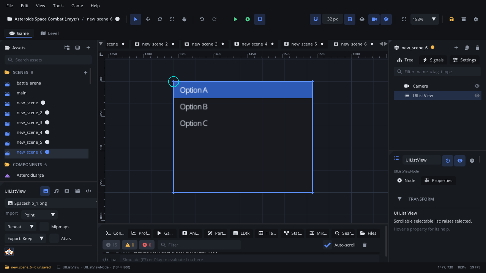

## What it's for

A List View is a box of text rows where one row is selected. The player
clicks a row, or moves the selection with the arrow keys. Use it for a
simple pick-one list: save slots, levels, a character roster.

## When to use it

- **Picking one entry from a short list** that should stay visible, unlike a
  dropdown that folds away.
- **Menus driven by keyboard or gamepad**: it takes focus and moves its
  selection with Up / Down.
- **Not** for a few options in a small space: use a
  [Dropdown](UIDropdownNode.md) or a [Radio Group](UIRadioGroupNode.md).
- **Not** for nested entries: use a [Tree View](UITreeViewNode.md).
- **Not** for several columns: use a [Table](UITableNode.md).
- **Not** for a read-out list with bullets or numbers: use a
  [Bullet List](UIUnorderedListNode.md) or a
  [Numbered List](UIOrderedListNode.md).

## Using it

1. **Add Node** (Ctrl+A) > *UI List View*. It starts 200 x 160 px with three
   rows ("Option A", "Option B", "Option C"), the first one selected.
2. Put it under a [Screen Layer](ScreenLayerNode.md), or in a
   [UI Container](UIContainerNode.md).
3. In the Node tab's **Properties** section set **Selected Index** (0 is the
   first row, -1 none) and **Item Height** (16 to 48 px per row).
4. A script reads `selectedIndex` when the player confirms, for example from
   a button's `clicked` (see the example).

The rows themselves can't be changed in the editor or from Lua yet: a List
View made in the editor always has the three default rows.

## How it works

- **Layout**: the node's position is the top-left corner and **Size** the
  width and height. Rotation and scale don't change it. Rows are stacked
  from the top, **Item Height** each; the selected row is filled blue.
- **Mouse**: a click on a row selects it.
- **Keyboard and gamepad**: the list takes focus when clicked or reached
  with Tab, the arrow keys or the D-pad. While it has focus, Up / Down move
  the selection and stay on the list; Left / Right move the focus to the
  next control.
- The list doesn't scroll and doesn't clip its rows, so make it tall enough
  for all of them.
- **Screen space**: the mouse is read in screen coordinates. Keep the list
  under a Screen Layer (or where the camera doesn't move it) so clicks line
  up with the rows.
- The List View raises no signal when the selection changes (the Add Node
  description mentions `selected`, but this node doesn't have it). Read
  `selectedIndex` when you need it.

## Example

A level select: the list picks the level, a Start button loads it.

```lua
---@class LevelSelect : ScriptInstanceBase
local LevelSelect = {}

local LEVELS = { [0] = "level_1", [1] = "level_2", [2] = "level_3" }

function LevelSelect:ready()
    self.list = self.node:get_node("LevelList") ---@type UIListViewNode
    self.node:get_node("StartButton"):connect("clicked", function()
        local level = LEVELS[self.list.selectedIndex]
        if level then Scene.change_scene(level) end
    end)
end

return LevelSelect
```

The script is on the menu's container; the list and the button are its
children. `selectedIndex` counts from 0.

## Screenshot


