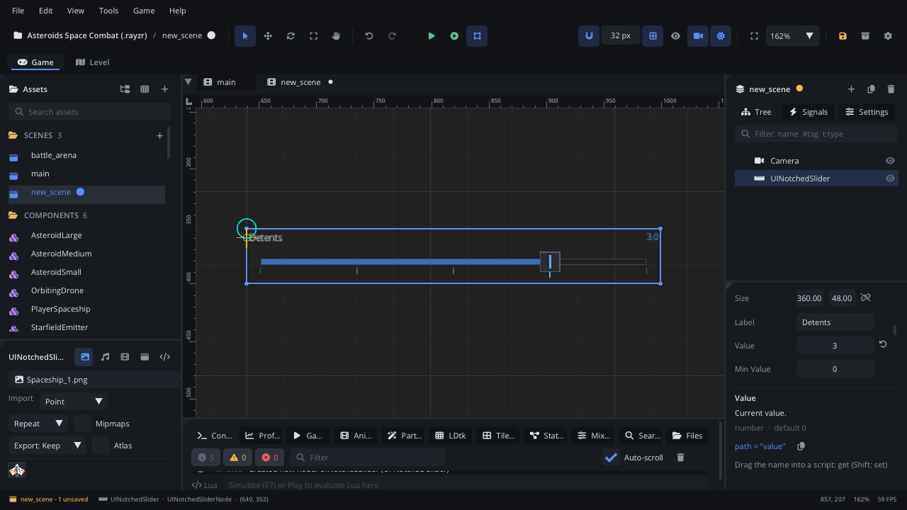

## What it's for

A Notched Slider is a slider with a fixed number of notches (detents) along
its track. The handle snaps to the nearest notch, so the player picks one of
a few steps: difficulty, quality presets, text speed, a 1-5 rating.

## When to use it

- **A setting with a few fixed steps**: Low / Medium / High graphics, text
  speed slow to fast, a mouse sensitivity from 1 to 10.
- **A value that should land on round numbers**, with Shift held for a free
  in-between value.
- **Not** for a smooth value with no steps: use a [Slider](UISliderNode.md),
  or a [Knob](UIKnobNode.md) where space is tight.
- **Not** for a choice between named options with no order: use a
  [Radio Group](UIRadioGroupNode.md) or a [Dropdown](UIDropdownNode.md).
- **Not** for audio levels in decibels: use a
  [Volume Fader](UIVolumeFaderNode.md).

## Using it

1. **Add Node** (Ctrl+A) > *UI Notched Slider*. It starts 360 x 48 px, with
   the label "Detents", a range of 0 to 4 and five notches.
2. Put it under a [Screen Layer](ScreenLayerNode.md) so it stays on screen,
   or inside a [UI Container](UIContainerNode.md) that lays it out with
   other controls.
3. In the Node tab's **Properties** section set **Label**, **Min Value**,
   **Max Value** and **Num Notches** (2 to 32). The notches are spread evenly
   from Min Value to Max Value, so 0 to 4 with five notches gives the steps
   0, 1, 2, 3, 4.
4. Set **Value** to the starting step. Turn **Snap To Notches** off for a
   slider that moves freely but still shows the notch marks.
5. **Orientation** turns it into a vertical slider (bottom = Min Value).
   Make **Size** tall and narrow to match.
6. Attach a script and handle `value_changed`, or connect it in the Node
   tab's **Signals** section.

## How it works

- **Layout**: the node's position is the slider's top-left corner and
  **Size** is its width and height. Rotation and scale don't change it. The
  label is drawn top left and the current value top right (one decimal).
- **Mouse**: press anywhere on the slider and drag. The handle jumps to the
  mouse and snaps to the nearest notch. Hold Shift while dragging for fine
  mode: the value moves freely between notches and the readout shows
  `FINE:` with two decimals.
- **Snap To Notches** off: dragging gives any value in the range.
- The value is always kept between Min Value and Max Value.
- `value_changed` fires only when the value really changes, so dragging
  within one notch raises nothing.
- **In the world or on screen**: under a [Screen Layer](ScreenLayerNode.md)
  it stays on screen; outside one it's drawn in the world (the camera moves
  it) and reads the mouse there too, so clicks line up either way.
- **Notch Labels** (one a line, left to right) name the notches under the
  track; without them the slider shows its numbers. Scripts:
  `node:ui_set_items({"Off", "Low", "High"})`.

## Signals

| Signal | When | Value |
|---|---|---|
| `value_changed` | The value changes (a drag, or a jump to another notch) | The new value (a number) |

## Example

A difficulty setting with three steps (Min Value 0, Max Value 2, Num
Notches 3). The script on the slider keeps the choice in a save.

```lua
---@class DifficultySlider : ScriptInstanceBase
local DifficultySlider = {}

local NAMES = { [0] = "easy", [1] = "normal", [2] = "hard" }

function DifficultySlider:ready()
    self.node.value = Save.get("difficulty", 1)
end

function DifficultySlider:on_value_changed(value)
    local step = math.floor(value + 0.5)
    Save.set("difficulty", step)
    Log.info("Difficulty: " .. NAMES[step])
end

return DifficultySlider
```

`on_value_changed` runs on the slider's own script. From another node, use
`slider:connect("value_changed", function(value) ... end)`.

## Screenshot


