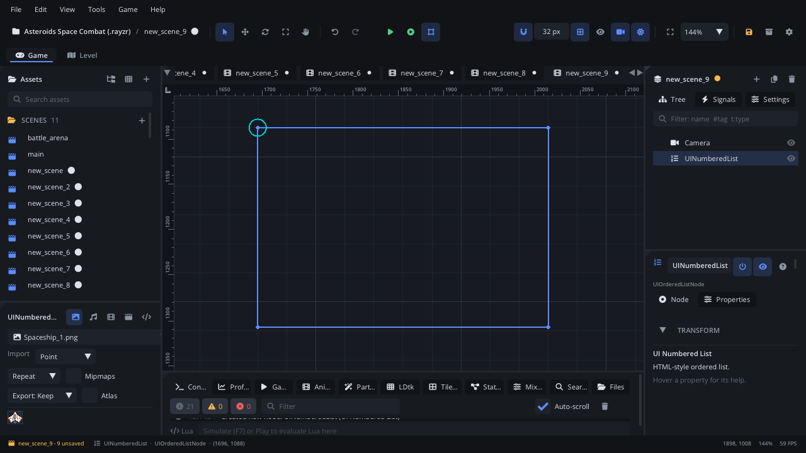

## What it's for

A Numbered List (an ordered list, like HTML's `<ol>`) shows rows of text
numbered 1, 2, 3 - or a, b, c, or i, ii, iii - in a framed box that
scrolls. Rows can be indented, styled as sub-headings and carry a small
badge. A click selects a row. Use it for steps in order: a tutorial's
steps, a recipe, a high-score table's places.

## When to use it

- **Steps or places in order**: "1. Find the key  2. Open the gate", a
  leaderboard, the stages of a quest.
- **Outlines** with Roman or letter numbering.
- **Not** when order doesn't matter: use a
  [Bullet List](UIUnorderedListNode.md).
- **Not** for a plain pick-one list driven by keys or a gamepad: use a
  [List View](UIListViewNode.md).
- **Not** for rows with several columns (name, score, time): use a
  [Table](UITableNode.md).

## Using it

1. **Add Node** (Ctrl+A) > *UI Numbered List*. It starts 320 x 220 px with
   no rows.
2. Put it under a [Screen Layer](ScreenLayerNode.md), or in a
   [UI Container](UIContainerNode.md).
3. In the Node tab's **Properties** section pick the **Numbering** (Decimal
   `1.`, AlphaLower `a.`, AlphaUpper `A.`, RomanLower `i.`, RomanUpper
   `I.`), the **Start Number** (the first row's number, 1 to 100), the
   **Item Height** (16 to 48 px) and the **Selected Index** (from 0).

Set the items in the Node tab's **Items** box, one a line; two spaces at
the start nest an item a level deeper (numbered on its own). Scripts:
`node:ui_set_items({"Open the menu", "Pick a slot", "  Confirm"})`.

## How it works

- **Layout**: the node's position is the top-left corner and **Size** the
  width and height. Rotation and scale don't change it. The list has a dark
  frame with a border; rows start 6 px from the top, **Item Height** each.
- **Numbers**: rows count up from **Start Number**. Heading rows don't use
  up a number. A row can carry its own number instead, and nested rows
  (indented 20 px per level) keep counting with the rest.
- **Styles**: letters run a to z and then start again; Roman numerals go up
  to 39 (XXXIX).
- **Scrolling**: rows that don't fit scroll in the box, which clips them.
- **Selection**: the selected row is filled blue. A click on another row
  selects it and raises `selected`.
- **In the world or on screen**: under a [Screen Layer](ScreenLayerNode.md)
  it stays on screen; outside one it's drawn in the world (the camera moves
  it) and reads the mouse there too, so clicks line up either way.

## Signals

| Signal | When | Value |
|---|---|---|
| `selected` | A click selects a different row | The row's index (from 0) |

## Example

Number a chapter's steps with Roman numerals, continuing from the previous
page, and report the step the player clicks.

```lua
---@class StepList : ScriptInstanceBase
local StepList = {}

StepList.properties = {
    first_step = { type = "int", default = 1, label = "First Step" },
}

function StepList:ready()
    self.node.numbering = "RomanUpper"
    self.node.startNumber = self.first_step
end

function StepList:on_selected(index)
    Log.info("Step " .. (self.first_step + index) .. " clicked")
end

return StepList
```

The script is on the list. `first_step` is set per list in the Inspector's
**Properties** tab.

## Screenshot


