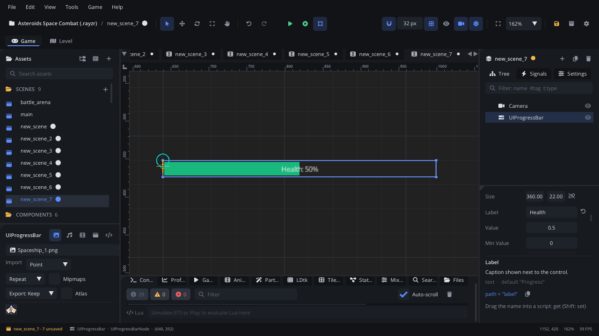

## What it's for

A UI Progress Bar shows how full something is: health, stamina, a loading
bar, a boss's life, experience to the next level. It fills from one end in
proportion to its value and can show the percentage.

## When to use it

- **Health and other meters** in the HUD, under a
  [Screen Layer](ScreenLayerNode.md).
- **Loading and cooldowns**: set the value as the task goes on.
- **Vertical gauges**: set **Direction** to Vertical; it fills from the
  bottom up.
- **Not** for a value the player sets: use a [UI Slider](UISliderNode.md).
- **Not** for an audio level meter with peaks: use a
  [UI Volume Meter](UIVolumeMeterNode.md).

## Using it

1. **Add Node** (Ctrl+A) > *UI Progress Bar*. It is 360 x 22, labelled
   "Progress", from 0 to 1 at 0.5.
2. Put it under a [Screen Layer](ScreenLayerNode.md).
3. In the Node tab's **Properties** section set **Min Value**, **Max
   Value** and **Value**. Use the range that suits your game: 0 to 1, or
   0 to the character's maximum health.
4. **Fill Color** colours the filled part. **Show Text** shows the
   percentage; with a **Label** it reads "Health: 70%".
5. Change **Value** from a script as the game goes on (below).

## How it works

- **Fill**: the filled part is (value - min) / (max - min) of the bar,
  kept between empty and full. A value past either end just shows an
  empty or full bar.
- **Horizontal** fills from the left, with the label and percentage in the
  middle of the bar. **Vertical** fills from the bottom, shows the
  percentage in the middle and the label just above the bar.
- **Size**: for a vertical bar, give it a tall **Size** (for example
  28 x 160).
- **No input**: it doesn't take clicks or the keyboard focus, and raises
  no events of its own.

## Example

A health bar under a Screen Layer that follows the player's health. The
player's script calls `hurt` on the HUD.

```lua
---@class HealthBar : ScriptInstanceBase
local HealthBar = {}

HealthBar.properties = {
    max_health = { type = "int", default = 100, label = "Max Health" },
}

function HealthBar:ready()
    self.health = self.max_health
    self.node:set_property("minValue", 0)
    self.node:set_property("maxValue", self.max_health)
    self.node:set_property("value", self.health)
end

function HealthBar:hurt(amount)
    self.health = math.max(0, self.health - amount)
    self.node:set_property("value", self.health)
    if self.health <= self.max_health * 0.25 then
        self.node:set_property("fillColor", "#e53e3e")
    end
end

return HealthBar
```

The script is on the progress bar; the player calls
`Scene.find_node("HealthBar"):get_script():hurt(10)`.

## Screenshot


