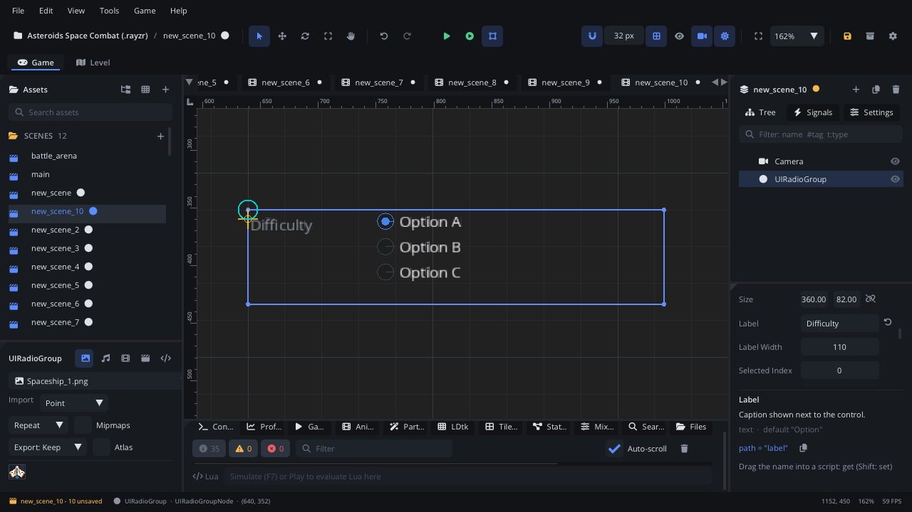

## What it's for

A UI Radio Group shows a few options as round buttons, one of which is on:
picking one turns the others off. Every option stays visible, so the
player sees the whole choice at a glance.

## When to use it

- **One choice out of a few**: difficulty, control scheme, a character's
  class.
- **A row of choices**: turn on **Horizontal** for options side by side.
- **Not** for many options or little space: use a
  [UI Dropdown](UIDropdownNode.md).
- **Not** for independent on / off options: use
  [UI Checkboxes](UICheckboxNode.md).

## Using it

1. **Add Node** (Ctrl+A) > *UI Radio Group*. It is 360 px wide, labelled
   "Option", with the options Option A, Option B and Option C in a column.
2. Put it under a [Screen Layer](ScreenLayerNode.md) or in a
   [UI Container](UIContainerNode.md).
3. In the Node tab's **Properties** section set **Label**, **Label Width**
   (the room for the label on the left), **Selected Index** (the option on
   at the start, counting from 0) and **Default Index**.
4. Turn on **Horizontal** to lay the options out in a row. Adjust **Size**
   to fit: a column needs about 26 px per option.
5. Handle `value_changed` (below).

Set the options in the Node tab's **Options** box, one a line (saved with
the scene). A script can replace them with `node:ui_set_items({...})` and
read them with `node:ui_get_items()`.

## How it works

- **Mouse**: a click on an option selects it.
- **Keyboard and gamepad**: Tab / Shift+Tab or the arrow keys focus the
  group. Then Up and Down (Left and Right when **Horizontal**) move the
  selection, wrapping round at the ends. The other arrows move the focus
  on to the next control.
- **Selected Index** counts from 0: the first option is 0.
- `value_changed` fires only when the selection changes. Setting
  **Selected Index** from a script doesn't raise it.

## Signals

| Signal | When | Value |
|---|---|---|
| `value_changed` | Another option is selected | The option's index, from 0 |

## Example

A difficulty choice that sets how much damage the player takes.

```lua
---@class DifficultyOption : ScriptInstanceBase
local DifficultyOption = {}

local DAMAGE = { [0] = 0.5, [1] = 1.0, [2] = 1.5 } -- easy, normal, hard

function DifficultyOption:ready()
    self.node:set_property("selectedIndex", Save.get("difficulty", 1))
end

function DifficultyOption:on_value_changed(index)
    Save.set("difficulty", index)
    Save.set("damage_scale", DAMAGE[index])
end

return DifficultyOption
```

The script is on the radio group.

## Screenshot


