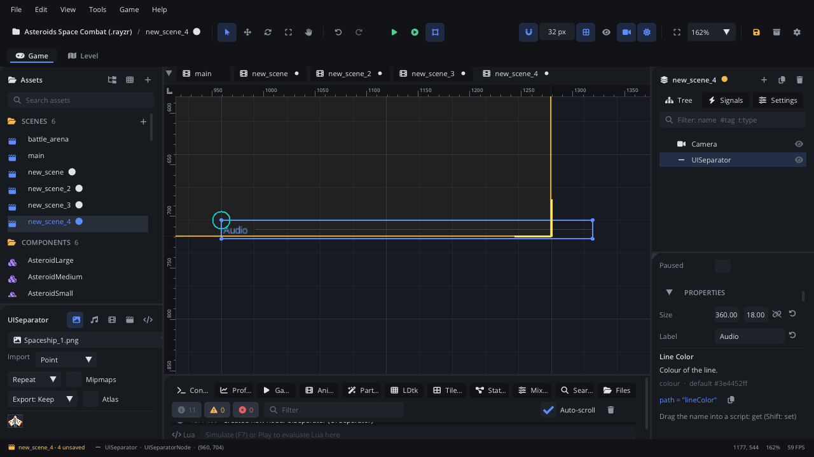

## What it's for

A Separator is a thin horizontal line that divides a menu into groups,
optionally with a short heading in front of it ("Audio", "Controls"). It
draws only; it takes no input.

## When to use it

- **Grouping rows in a menu**: a line between the audio and the video
  settings, with the group's name as its label.
- **Breaking up a long list of controls** in a [UI Container](UIContainerNode.md).
- **Not** for a heading on its own: use a [Label](UILabelNode.md).
- **Not** for a framed group with a title bar: use a
  [UI Container](UIContainerNode.md) with its header turned on.
- **Not** for switching between groups: use a
  [Tab Container](UITabContainerNode.md).

## Using it

1. **Add Node** (Ctrl+A) > *UI Separator*. It starts 360 x 10 px with no
   label: a plain line.
2. Put it in a [UI Container](UIContainerNode.md) between two groups of
   controls, or under a [Screen Layer](ScreenLayerNode.md).
3. In the Node tab's **Properties** section type a **Label** for a heading,
   and pick a **Line Color**.
4. With a label, make **Size** about 18 px high so the text fits.

## How it works

- The node's position is the top-left corner and **Size** the width and
  height. Rotation and scale don't change it.
- The line runs across the middle of that height, from the left edge to the
  right edge.
- With a **Label**, the text is drawn at the left in blue (13 px) and the
  line starts just after it; the separator is then at least 18 px tall.
  The label colour is fixed; **Line Color** is the line only.
- In a [UI Container](UIContainerNode.md) the container sets its position.
  In a vertical container with Stretch alignment (the default) it also sets
  the width, so the line spans the column.
- It has no signals and no input, and isn't focused by Tab or arrow keys.

## Example

Labels can be set from a script, for example to show translated text from
the project's locale files.

```lua
---@class OptionsMenu : ScriptInstanceBase
local OptionsMenu = {}

function OptionsMenu:ready()
    self.node:get_node("AudioSeparator").label = tr("options.audio")
    self.node:get_node("VideoSeparator").label = tr("options.video")
end

return OptionsMenu
```

The script is on the menu's container; the separators are its children.

## Screenshot


