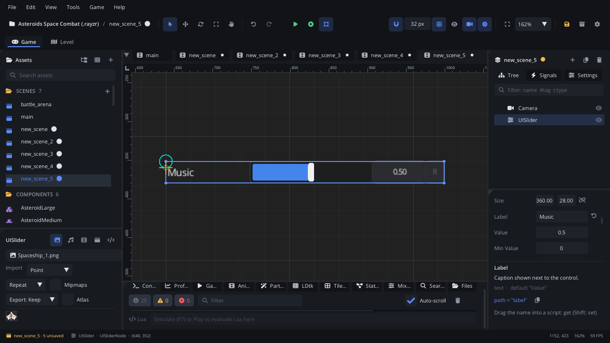

## What it's for

A UI Slider sets a number by dragging along a track: music volume, mouse
sensitivity, brightness, field of view. Next to the track it shows the
value in a box you can click to type a number, and a reset button that
puts the default back.

## When to use it

- **Settings with a range**: volumes, sensitivity, text size, difficulty
  as a number.
- **Whole numbers in a range**: turn on **Is Integer** for a count (number
  of bots, a level from 1 to 10).
- **Not** for a value that only shows progress: use a
  [UI Progress Bar](UIProgressBarNode.md), which the player can't drag.
- **Not** for a few fixed steps with marks: a
  [UI Notched Slider](UINotchedSliderNode.md) snaps to detents.
- **Not** for a mixer-style dB fader: use a
  [UI Volume Fader](UIVolumeFaderNode.md). For a small rotary control, use
  a [UI Knob](UIKnobNode.md).

## Using it

1. **Add Node** (Ctrl+A) > *UI Slider*. It is 360 x 28, labelled "Value",
   from 0 to 1 at 0.5.
2. Put it under a [Screen Layer](ScreenLayerNode.md) or in a
   [UI Container](UIContainerNode.md).
3. In the Node tab's **Properties** section set **Label**, **Min Value**,
   **Max Value**, **Value** and **Default Value** (what reset puts back).
4. **Label Width** is the room for the label on the left; **Is Integer**
   rounds to whole numbers; **Show Reset Button** shows the small reset
   button at the right end; **Fine Scale** is the drag speed with Shift
   held.
5. Handle `value_changed` (below) to use the value.

## How it works

- **Layout**: the label on the left (**Label Width**, none without a
  label), then the track, the value box, and the reset button if shown.
- **Mouse**: a click on the track jumps to that point, and dragging moves
  the value. With Shift held, dragging is fine: the value moves by
  **Fine Scale** times the normal amount, from where it was.
- **Typing**: click the value box (or Ctrl+click the track) to type a
  number. Enter or a click elsewhere sets it; Escape cancels.
- **Reset**: the reset button or a right-click on the track sets
  **Default Value**.
- **Keyboard and gamepad**: Tab / Shift+Tab or the arrow keys move the
  focus between controls. On a focused slider, Left and Right change the
  value by 5% of the range (1% with Shift; at least 1 with **Is Integer**),
  and Enter starts typing a value.
- **Limits**: the value is always kept between **Min Value** and **Max
  Value**, and rounded with **Is Integer**.
- `value_changed` fires for every change, so it fires many times during a
  drag.

## Signals

| Signal | When | Value |
|---|---|---|
| `value_changed` | The value changes: dragging, a click, typing, the keys or a reset | The new value (a number) |

## Example

A music volume slider that drives the mixer and is remembered between
runs.

```lua
---@class MusicVolume : ScriptInstanceBase
local MusicVolume = {}

function MusicVolume:ready()
    local slider = self.node ---@type UISliderNode
    slider:set_property("minValue", 0)
    slider:set_property("maxValue", 1)
    slider:set_property("value", Save.get("music_volume", 0.8))
    Audio.set_bus_volume("music", slider:get_property("value"))
end

function MusicVolume:on_value_changed(value)
    Audio.set_bus_volume("music", value)
    Save.set("music_volume", value)
end

return MusicVolume
```

The script is on the slider. Setting `value` from a script doesn't raise
`value_changed`, so `ready` sets the bus itself.

## Screenshot


