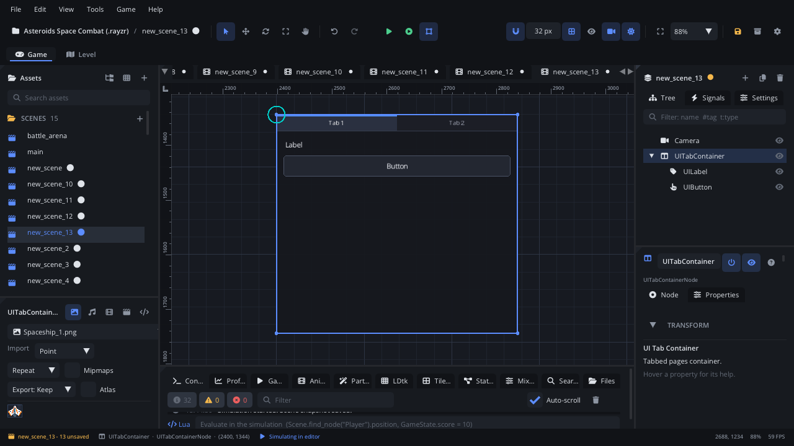

## What it's for

A Tab Container is a [UI Container](UIContainerNode.md) with a row of tabs
along its top (or a column down its side). It lays out its UI children
like a container does, and the player clicks a tab or uses the arrow keys
to pick one. Use it for options menus split into pages, or a character
screen with Stats / Items / Skills.

## When to use it

- **A panel with tabs on top** in an options or character screen.
- **Not** for a plain panel that arranges controls: use a
  [UI Container](UIContainerNode.md).
- **Not** for a row of command buttons: use a [Toolbar](UIToolbarNode.md).
- **Not** for a thin divider between groups: use a
  [Separator](UISeparatorNode.md).

## Using it

1. **Add Node** (Ctrl+A) > *UI Tab Container*. It starts 440 x 400 px with
   two tabs, "Tab 1" and "Tab 2", the first one active.
2. Put it under a [Screen Layer](ScreenLayerNode.md).
3. Add UI nodes as its children (select it, then Add Node): labels,
   buttons, sliders. It stacks them below the tabs.
4. In the Node tab's **Properties** section set **Tab Direction**
   (Horizontal: tabs along the top; Vertical: down the left side),
   **Tab Size** (the tabs' height, or their width when vertical) and
   **Active Tab** (from 0).
5. The layout settings are a UI Container's: **Direction**, **Alignment**,
   **Spacing**, the four paddings and **Columns**, plus **Background
   Color** and **Border Color**.

Set the tabs in the Node tab's **Tab Names** box, one title a line (a new
container has "Tab 1" and "Tab 2"). Scripts: `node:ui_set_items({"Video",
"Audio", "Controls"})`.

## How it works

- **Layout**: the node's position is the top-left corner and **Size** the
  width and height. Rotation and scale don't change it. Horizontal tabs
  share the width equally along the top; vertical tabs share the height
  down the left edge.
- **Children** are laid out inside, below the tabs (or right of them when
  vertical), by the container settings, the same way a
  [UI Container](UIContainerNode.md) does. The layout runs while the game
  runs (and in Simulate); while you edit, the children stay where you put
  them.
- **Tabs and children**: the active tab is only highlighted. All the
  children are shown whichever tab is active - the tabs don't hide them.
  To show a page per tab, a script can enable one child container per tab
  by `activeTab` (see the example).
- **Mouse**: a click on a tab makes it active.
- **Keyboard and gamepad**: the container takes focus when clicked or
  reached with Tab. While it has focus, Left / Right (Up / Down for
  vertical tabs) switch tabs, wrapping round at the ends.
- **Not used**: the UI Container's **Title** and header aren't drawn, and
  the background and border are always drawn (**Draw Background** / **Draw
  Border** are ignored). **Show Header** on only adds **Header Height** of
  space above the children.
- It raises no signal when the tab changes; read `activeTab`.
- **In the world or on screen**: under a [Screen Layer](ScreenLayerNode.md)
  it stays on screen; outside one it's drawn in the world (the camera moves
  it) and reads the mouse there too, so clicks line up either way.

## Example

One page per tab: two child containers, "AudioPage" and "VideoPage". The
script shows the page of the active tab.

```lua
---@class OptionsTabs : ScriptInstanceBase
local OptionsTabs = {}

function OptionsTabs:ready()
    self.pages = {
        [0] = self.node:get_node("AudioPage"),
        [1] = self.node:get_node("VideoPage"),
    }
    self.shown = -1
end

function OptionsTabs:update(dt)
    local tab = self.node.activeTab
    if tab == self.shown then return end
    self.shown = tab
    for i, page in pairs(self.pages) do
        page:set_enabled(i == tab)
    end
end

return OptionsTabs
```

A disabled page isn't drawn, doesn't take clicks and is left out of the
layout, so the shown page moves up to the top.

## Screenshot


