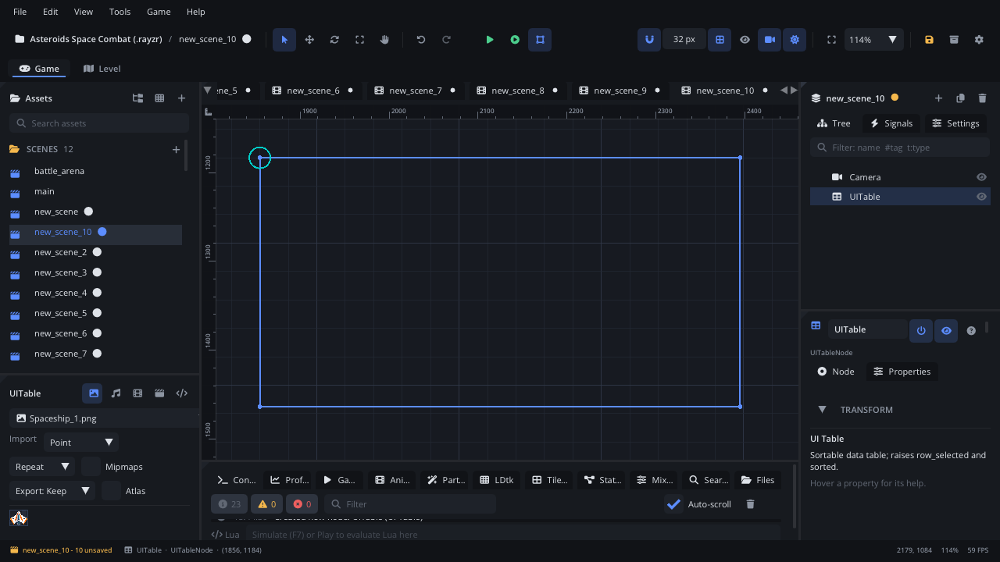

## What it's for

A Table (like HTML's `<table>`) shows rows of data in columns under a
header row, with striped rows, a selected row, a sort arrow on the sorted
column and a scrollbar for long tables. Use it for leaderboards, save-slot
details, shop stock or a debug view of game data.

## When to use it

- **Data with several fields per row**: name, score and time; item, price
  and stock.
- **A list the player can sort** by clicking a column header.
- **Not** for a single column of choices: use a
  [List View](UIListViewNode.md).
- **Not** for a read-out list: use a [Bullet List](UIUnorderedListNode.md)
  or a [Numbered List](UIOrderedListNode.md).
- **Not** for nested data: use a [Tree View](UITreeViewNode.md).

## Using it

1. **Add Node** (Ctrl+A) > *UI Table*. It starts 540 x 280 px with no
   columns and no rows.
2. Put it under a [Screen Layer](ScreenLayerNode.md), or in a
   [UI Container](UIContainerNode.md).
3. In the Node tab's **Properties** section set **Header Height** (20 to
   60 px), **Row Height** (18 to 48 px), **Selected Row** (from 0),
   **Sort Column** (from 0) and **Sort Ascending**.

Set **Columns** and **Rows** in the Node tab, one a line. A column is
`Title`, or `Title|width` (a width of 1 or less is a share of the table,
more is pixels); a row is its cells split by `|`, like `Ada|1200|Gold`.
Scripts: `node:set_property("columns", {...})`, and
`node:ui_set_items({"Ada|1200", "Bo|900"})` for the rows.

## How it works

- **Layout**: the node's position is the top-left corner and **Size** the
  width and height. Rotation and scale don't change it. The header row is
  **Header Height** tall; the body below it scrolls, with a 14 px
  scrollbar at the right, and clips its rows.
- **Columns**: each column has a title, an alignment (left, centre or
  right) and a width. A width of 1 or less is a share of the free width; a
  larger width is in pixels.
- **Cells** hold text (with an optional colour) or a small badge.
- **Rows**: every other row is shaded; the selected row is filled blue. A
  click on a row selects it.
- **Sorting**: a click on a sortable column's header makes it the
  **Sort Column**, or flips **Sort Ascending** if it already is, and moves
  the arrow (`^` ascending, `v` descending). The table doesn't reorder the
  rows itself.
- **Screen space**: the mouse is read in screen coordinates. Keep the table
  under a Screen Layer (or where the camera doesn't move it) so clicks line
  up with the rows.

## Signals

| Signal | When | Value |
|---|---|---|
| `row_selected` | The selected row changes | The row's index (from 0) |
| `sorted` | The sort column or order changes | - |

Both signals are listed in the Node tab's **Signals** section, but for now
a game doesn't raise them: a click on a row or a header doesn't fire them.
Read `selectedRow`, `sortColumn` and `sortAscending` instead.

## Example

Check the table's sort order each frame and log when the player changes it.

```lua
---@class Leaderboard : ScriptInstanceBase
local Leaderboard = {}

function Leaderboard:ready()
    self.node.sortColumn = 1        -- the score column
    self.node.sortAscending = false -- highest first
    self.last = "1/false"
end

function Leaderboard:update(dt)
    local now = self.node.sortColumn .. "/" .. tostring(self.node.sortAscending)
    if now ~= self.last then
        self.last = now
        Log.info("Sorted by column " .. self.node.sortColumn)
    end
end

return Leaderboard
```

## Screenshot


