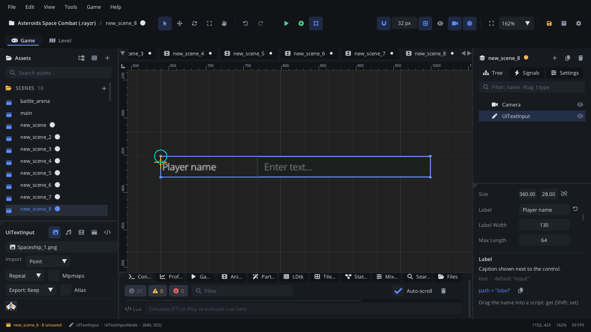

## What it's for

A UI Text Input is a one-line field the player types into: a name for the
high-score table, a save slot's name, a cheat code. It shows a placeholder
while empty, raises `value_changed` as the text changes and `submitted`
when the player presses Enter.

## When to use it

- **Short typed text**: a player name, a seed for a level generator, a
  code.
- **Not** for numbers in a range: a [UI Slider](UISliderNode.md) has a box
  you can type a number into, and keeps it in range.
- **Not** for choosing from known values: use a
  [UI Dropdown](UIDropdownNode.md) or a [UI Radio Group](UIRadioGroupNode.md).
- **Not** for showing text: that's a [UI Label](UILabelNode.md).

## Using it

1. **Add Node** (Ctrl+A) > *UI Text Input*. It is 360 x 28, labelled
   "Input", with the placeholder "Enter text...".
2. Put it under a [Screen Layer](ScreenLayerNode.md) or in a
   [UI Container](UIContainerNode.md).
3. In the Node tab's **Properties** section set **Label**, **Label Width**
   (the room for the label on the left) and **Max Length** (the most
   characters it accepts, up to 255).
4. Handle `submitted` (or `value_changed`) in a script (below).

## How it works

- **Focus**: click the field to type into it. A click anywhere else,
  Escape, or Enter ends typing. Tab / Shift+Tab also move the focus to and
  from it.
- **Typing**: printable ASCII characters (letters, digits, punctuation,
  space) are added at the end. Backspace removes the last character. There
  is no text cursor to move, and no selection or paste.
- **Enter** raises `submitted` with the text and leaves the field.
- **Max Length**: characters past it are ignored.
- **Reading the text**: scripts get it from the events' value; there is no
  `get_text` for this node.
- **Keys go to the game too**: while the player types, the game's input
  actions still see the keys. Pause the game, or ignore actions in your
  scripts, while a name is being entered.

## Signals

| Signal | When | Value |
|---|---|---|
| `value_changed` | A character is typed or removed | The whole text so far |
| `submitted` | Enter is pressed in the field | The text |

## Example

A high-score name entry: the name is kept as it is typed and saved when
the player presses Enter.

```lua
---@class NameEntry : ScriptInstanceBase
local NameEntry = {}

function NameEntry:ready()
    self.name = ""
end

function NameEntry:on_value_changed(text)
    self.name = text
end

function NameEntry:on_submitted(text)
    if text == "" then return end
    local scores = Save.get("high_scores", {})
    table.insert(scores, { name = text, score = Save.get("last_score", 0) })
    Save.set("high_scores", scores)
    Scene.change_scene("scenes/high_scores.scene.json")
end

return NameEntry
```

The script is on the text input.

## Screenshot


