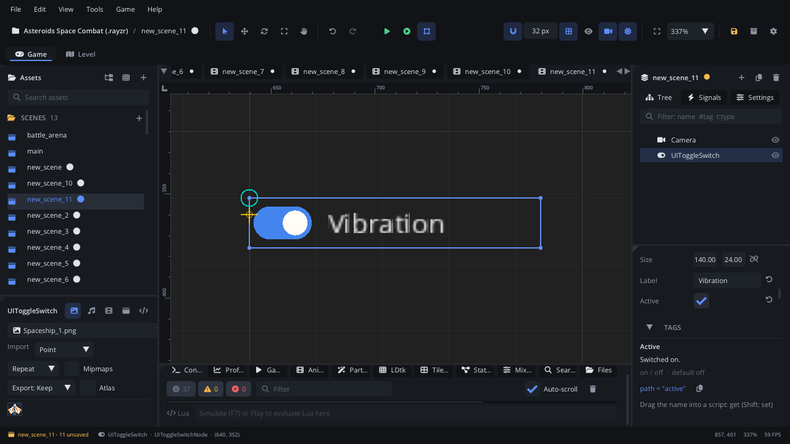

## What it's for

A UI Toggle Switch is an on / off switch with a label, like the switches
in a phone's settings. The knob slides right and the track lights up when
it's on.

## When to use it

- **An on / off setting that reads as a switch**: vibration, music on,
  show the FPS.
- **Not** when a script must react to the change at once: the switch
  raises no event, so a [UI Checkbox](UICheckboxNode.md) (with
  `value_changed`) is easier to use.
- **Not** for an action: use a [UI Button](UIButtonNode.md).

## Using it

1. **Add Node** (Ctrl+A) > *UI Toggle Switch*. It is 140 x 24, labelled
   "Toggle", off.
2. Put it under a [Screen Layer](ScreenLayerNode.md) or in a
   [UI Container](UIContainerNode.md).
3. In the Node tab's **Properties** section set **Label** and **Active**
   (on or off when the scene starts).
4. Read **Active** from a script when you need it (below).

## How it works

- **Mouse**: a click anywhere on it flips it.
- **Keyboard and gamepad**: Tab / Shift+Tab or Up / Down move the focus to
  it. On the focused switch, Enter, Space or the gamepad's A button flips
  it, Right turns it on and Left turns it off.
- **`value_changed`** fires when the switch flips (by click, key or
  gamepad), with its new state; a script can also read `active` any time.

## Example

A "Show FPS" switch: the script on the switch shows or hides an FPS label
whenever the switch changes.

```lua
---@class ShowFpsSwitch : ScriptInstanceBase
local ShowFpsSwitch = {}

function ShowFpsSwitch:ready()
    self.label = Scene.find_node("FpsLabel") ---@type UILabelNode
    self.node:set_property("active", Save.get("show_fps", false))
    self.was = nil
end

function ShowFpsSwitch:update(dt)
    local on = self.node:get_property("active")
    if on ~= self.was then
        self.was = on
        self.label:set_visible(on)
        Save.set("show_fps", on)
    end
    if on then
        self.label:set_text("FPS: " .. Engine.get_fps())
    end
end

return ShowFpsSwitch
```

## Screenshot


