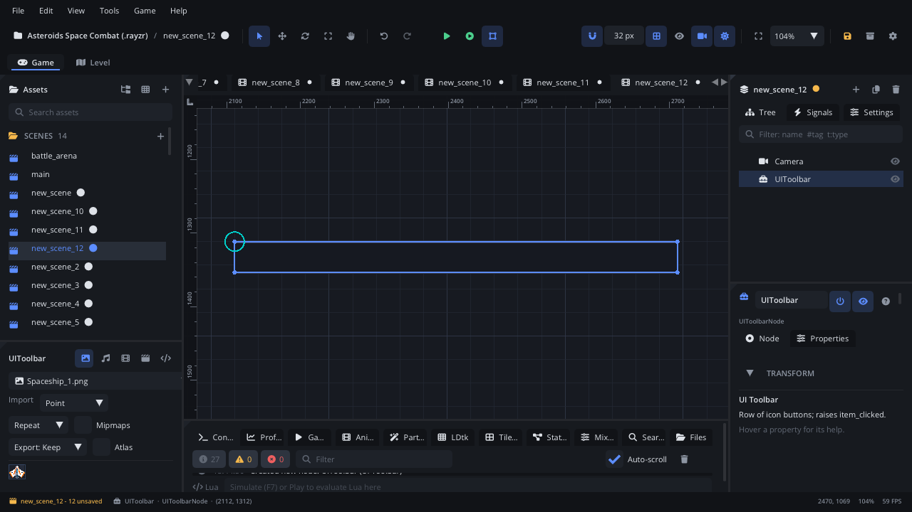

## What it's for

A Toolbar is a bar with a row of icon buttons, like an application's tool
row: buttons, toggle buttons that stay pressed, separators and gaps, each
with a tooltip. It suits level editors and tools built in the game, a
photo mode, or a strategy game's command bar.

## When to use it

- **A row of commands with icons**: build, demolish, rotate, undo.
- **Tool modes** where one toggle is pressed at a time.
- **Not** for one or two buttons: use a [Button](UIButtonNode.md).
- **Not** for switching between pages of controls: use a
  [Tab Container](UITabContainerNode.md).
- **Not** for an icon that isn't clickable: use an [Icon](UIIconNode.md).

## Using it

1. **Add Node** (Ctrl+A) > *UI Toolbar*. It starts 600 x 42 px with no
   buttons: an empty bar.
2. Put it under a [Screen Layer](ScreenLayerNode.md), usually anchored to
   the top or bottom of the screen.
3. In the Node tab's **Properties** section set **Button Size** (each
   button's width and height, 34 x 32 by default), **Spacing** (the gap
   between items) and **Active Toggle Id** (the pressed toggle, -1 for
   none).

Set the buttons in the Node tab's **Items** box, one a line:
`Icon|Label|Tooltip` (an icon name such as `Save`, either part may be
empty; start with `toggle:` for a toggle), `-` for a separator and `~` for
a spacer. A button's id is its line number (1, 2, ...). Scripts:
`node:ui_set_items({"Save|Save|Save the game", "-", "toggle:|Grid"})`.

## How it works

- **Layout**: the node's position is the top-left corner and **Size** the
  width and height. Rotation and scale don't change it. Items run from the
  left (8 px in), centred vertically, **Spacing** apart.
- **Items**: a button or a toggle shows an icon, a label or both; a label
  makes the button wider than **Button Size**. A separator draws a thin
  vertical line, a spacer leaves a gap. Each item has a number (its id).
- **Mouse**: hovering a button highlights it and shows its tooltip.
  Pressing it raises `item_clicked` with its id. A toggle also flips: when
  it turns on it becomes the **Active Toggle Id**, when it turns off that
  goes back to -1. Disabled items ignore clicks.
- It isn't reached with Tab or the arrow keys; it's mouse only.
- **Screen space**: the mouse is read in screen coordinates. Keep the
  toolbar under a Screen Layer so clicks line up with the buttons.

## Signals

| Signal | When | Value |
|---|---|---|
| `item_clicked` | A button or toggle is pressed | The item's id |

## Example

React to the toolbar's buttons by id.

```lua
---@class BuildBar : ScriptInstanceBase
local BuildBar = {}

local TOOLS = { [1] = "build", [2] = "demolish", [3] = "rotate" }

function BuildBar:ready()
    self.tool = "build"
end

function BuildBar:on_item_clicked(id)
    self.tool = TOOLS[id] or self.tool
    Log.info("Tool: " .. self.tool)
end

return BuildBar
```

The script is on the toolbar, so `on_item_clicked` receives its signal.

## Screenshot


