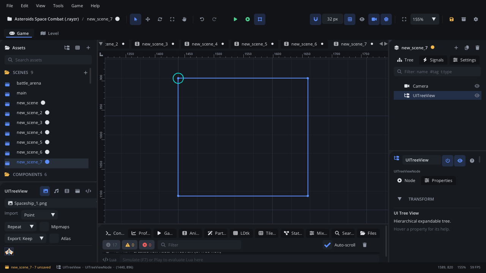

## What it's for

A Tree View shows a hierarchy of rows - parents with indented children and
a box to expand or collapse them - with one row selected. It suits an
in-game encyclopedia, a quest log grouped by chapter, or a file list in a
tool.

## When to use it

- **Entries grouped under headings** that the player opens and closes.
- **Nested data** in a debug or tool screen.
- **Not** for a flat list: use a [List View](UIListViewNode.md).
- **Not** for rows with several columns: use a [Table](UITableNode.md).
- **Not** for a read-out list with indented bullets: use a
  [Bullet List](UIUnorderedListNode.md).

## Using it

1. **Add Node** (Ctrl+A) > *UI Tree View*. It starts 220 x 200 px and
   empty: a dark box with a border.
2. Put it under a [Screen Layer](ScreenLayerNode.md), or in a
   [UI Container](UIContainerNode.md).
3. In the Node tab's **Properties** section set **Item Height** (16 to 48 px
   per row) and **Selected Id** (the id of the selected row, -1 for none).

Set the items in the Node tab's **Items** box, one a line; two spaces at
the start nest an item under the one above it (`Weapons`, then
`  Sword`). Scripts: `node:ui_set_items({"Weapons", "  Sword", "  Bow"})`.

## How it works

- **Layout**: the node's position is the top-left corner and **Size** the
  width and height. Rotation and scale don't change it. Rows are stacked
  from the top, **Item Height** each, indented 16 px per level; rows
  outside the box are clipped.
- **Selection** is by row id, not position: **Selected Id** matches a row's
  id.
- **Mouse**: a click on a row selects it; a click on a parent's box expands
  or collapses it.
- **Keyboard and gamepad**: the tree takes focus when clicked or reached
  with Tab. While it has focus, Up / Down move the selection, Left
  collapses the row, Right expands it, and Enter or Space toggles a parent.
  The tree keeps all four arrow keys while focused; press Tab to move on.
- **In the world or on screen**: under a [Screen Layer](ScreenLayerNode.md)
  it stays on screen; outside one it's drawn in the world (the camera moves
  it) and reads the mouse there too, so clicks line up either way.
- **Collapsed** parents hide their children; Up / Down skip hidden rows.
- The Tree View raises no signal when the selection changes; read
  `selectedId`.

## Example

Show or hide a tree with a key, and start with nothing selected.

```lua
---@class CodexPanel : ScriptInstanceBase
local CodexPanel = {}

function CodexPanel:ready()
    self.tree = self.node:get_node("Codex") ---@type UITreeViewNode
    self.tree.selectedId = -1
    self.tree:set_visible(false)
end

function CodexPanel:update(dt)
    if Input.is_key_pressed("C") then
        self.tree:set_visible(not self.tree:is_visible())
    end
end

return CodexPanel
```

## Screenshot


