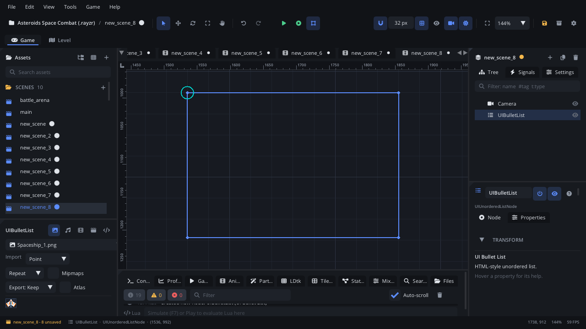

## What it's for

A Bullet List (an unordered list, like HTML's `<ul>`) shows rows of text
with a bullet in front of each, in a framed box that scrolls. Rows can be
indented, styled as sub-headings and carry a small badge. A click selects
a row. Use it for objectives, credits, patch notes or an inventory read-out.

## When to use it

- **A read-out list** where order doesn't matter: quest objectives, a
  character's traits, the items found.
- **Grouped rows**: headings with indented entries under them.
- **Not** for steps in order: use a [Numbered List](UIOrderedListNode.md).
- **Not** for a plain pick-one list driven by keys or a gamepad: use a
  [List View](UIListViewNode.md).
- **Not** for rows with several columns: use a [Table](UITableNode.md).
- **Not** for expandable groups: use a [Tree View](UITreeViewNode.md).

## Using it

1. **Add Node** (Ctrl+A) > *UI Bullet List*. It starts 320 x 220 px with no
   rows.
2. Put it under a [Screen Layer](ScreenLayerNode.md), or in a
   [UI Container](UIContainerNode.md).
3. In the Node tab's **Properties** section pick a **Default Bullet** (Disc,
   Circle, Square, Dash or Arrow), set **Item Height** (16 to 48 px) and
   **Selected Index** (the highlighted row, from 0).

The rows can't be added in the editor or from Lua yet (there's no Lua
function for them). An empty list draws nothing, so in the editor you only
see the selection outline of its area.

## How it works

- **Layout**: the node's position is the top-left corner and **Size** the
  width and height. Rotation and scale don't change it. The list has a dark
  frame with a border; rows start 6 px from the top, **Item Height** each.
- **Rows**: each row is indented 20 px per level, then the bullet, then the
  text. A heading row is drawn a little larger and brighter. A badge sits at
  the right end of its row. A row can have its own bullet instead of the
  default.
- **Scrolling**: rows that don't fit scroll in the box, which clips them.
- **Selection**: the selected row is filled blue. A click on another row
  selects it and raises `selected`.
- **Screen space**: the mouse is read in screen coordinates. Keep the list
  under a Screen Layer (or where the camera doesn't move it) so clicks line
  up with the rows.

## Signals

| Signal | When | Value |
|---|---|---|
| `selected` | A click selects a different row | The row's index (from 0) |

## Example

Change the bullet style and react to a click on a row.

```lua
---@class Objectives : ScriptInstanceBase
local Objectives = {}

function Objectives:ready()
    self.node.defaultBullet = "Arrow"
    self.node.selectedIndex = -1
end

function Objectives:on_selected(index)
    Log.info("Objective " .. (index + 1) .. " picked")
end

return Objectives
```

The script is on the list itself, so `on_selected` receives its `selected`
signal.

## Screenshot


