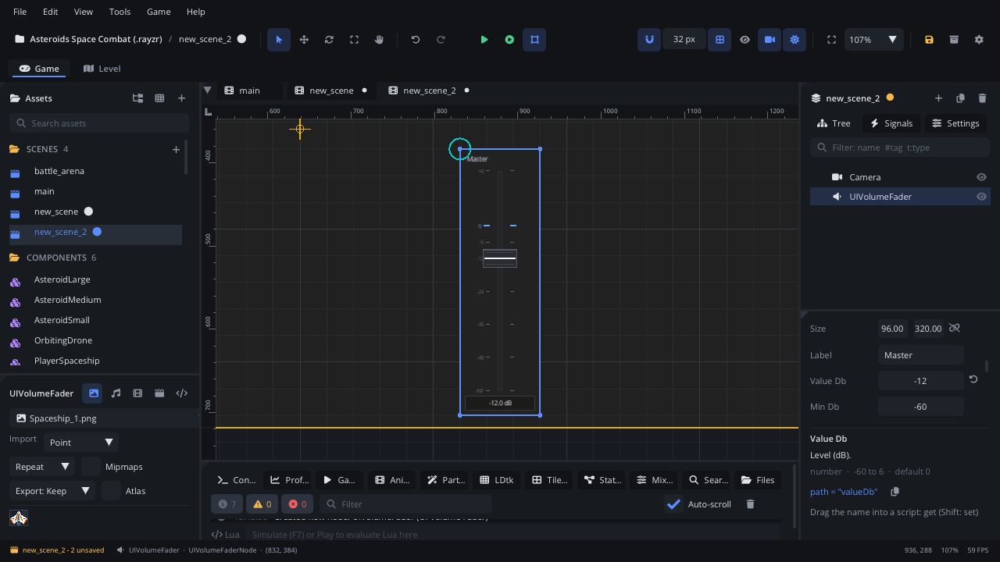

## What it's for

A Volume Fader is a mixing-desk style vertical fader that works in
decibels. Use it in an options menu or an in-game mixer to let the player
set the volume of a bus: Music, Effects, Voice.

## When to use it

- **Volume settings in dB**: a fader per bus in an audio options screen.
- **A level with a sensible "unchanged" point**: 0 dB sits about three
  quarters up the travel, with room above it to boost (up to **Max Db**).
- **Not** for showing how loud something is right now: use a
  [Volume Meter](UIVolumeMeterNode.md) next to it.
- **Not** for a plain 0-100 % value: use a [Slider](UISliderNode.md) or a
  [Knob](UIKnobNode.md).
- **Not** for a value with a few fixed steps: use a
  [Notched Slider](UINotchedSliderNode.md).

## Using it

1. **Add Node** (Ctrl+A) > *UI Volume Fader*. It starts 96 x 320 px, with
   the label "Master", at 0 dB, ranging from -60 dB to +6 dB.
2. Put it under a [Screen Layer](ScreenLayerNode.md), or in a
   [UI Container](UIContainerNode.md) with a row of faders.
3. In the Node tab's **Properties** section set **Label** (the bus name is a
   good choice), **Value Db** (the starting level), **Min Db** and
   **Max Db** (the ends of the travel) and **Default Db** (the level a
   right-click resets to).
4. The fader doesn't change any sound on its own. Attach a script and turn
   `value_changed` into a bus volume (see the example), or connect it in the
   Node tab's **Signals** section.

## How it works

- **Layout**: the node's position is the top-left corner and **Size** the
  width and height. Rotation and scale don't change it. The label is at the
  top, a dB scale (+6, 0, -6, -12, -24, -36, -48, -60) along the slot, and a
  readout at the bottom (`-INF dB` at the bottom of the travel).
- **Taper**: the travel isn't linear. 0 dB is at 75 % of the height; above
  it the fader runs up to **Max Db**, below it down to **Min Db**.
- **Mouse**: press on the fader and the cap jumps to the mouse; drag to
  move it. Hold Shift while dragging for fine mode: the cap moves from where
  it was, much more slowly, and the readout shows `FINE`. Right-click resets
  it to **Default Db**.
- The cap's centre line turns blue when the fader is at **Default Db**.
- The value is kept between Min Db and Max Db. `value_changed` fires only
  when it changes.
- **Screen space**: the mouse is read in screen coordinates. Keep the
  fader under a Screen Layer (or where the camera doesn't move it) so clicks
  line up with it.
- The project's mixer has its own faders in the editor's Mixer tab; this
  node is for the player's side. See the
  [audio mixer guide](../../engine/docs/audio_mixer.md).

## Signals

| Signal | When | Value |
|---|---|---|
| `value_changed` | The level changes (a drag, a click, a right-click reset) | The new level in dB |

## Example

A music fader for the options screen. `Audio.set_bus_volume` takes a linear
volume (1 = 0 dB), so the script converts from and to decibels.

```lua
---@class MusicFader : ScriptInstanceBase
local MusicFader = {}

local function to_db(v)
    if v <= 0 then return -60 end
    return 20 * math.log(v, 10)
end

local function from_db(db)
    if db <= -60 then return 0 end
    return 10 ^ (db / 20)
end

function MusicFader:ready()
    self.node.valueDb = to_db(Audio.get_bus_volume("Music"))
end

function MusicFader:on_value_changed(db)
    Audio.set_bus_volume("Music", from_db(db))
    Save.set("music_db", db)
end

return MusicFader
```

The script is on the fader. A [Volume Meter](UIVolumeMeterNode.md) beside
it can show the bus playing (`Audio.bus_peak`).

## Screenshot


