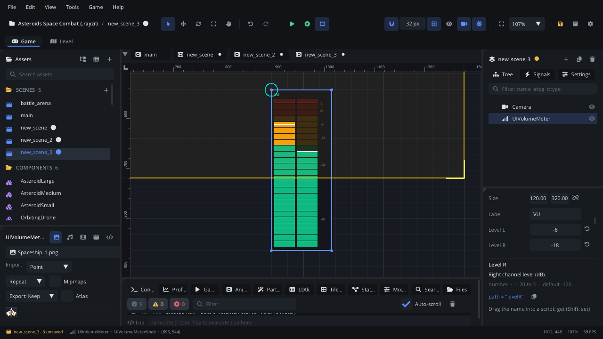

## What it's for

A Volume Meter is an LED-style level meter: a ladder of green, yellow and
red segments with a peak line and a clip light. It shows a level you give
it in decibels, in mono or stereo. Use it in an in-game mixer, a music
player, a rhythm game's HUD or a debug overlay.

## When to use it

- **Showing how loud a bus is**: next to a [Volume Fader](UIVolumeFaderNode.md)
  in an audio options screen, fed from `Audio.bus_peak`.
- **Any value that behaves like a level**: a microphone input, an engine's
  rev, a charge that peaks and falls.
- **Not** for a setting the player changes: the meter takes no input. Use a
  [Volume Fader](UIVolumeFaderNode.md) or a [Slider](UISliderNode.md).
- **Not** for a plain fill bar (health, loading): use a
  [Progress Bar](UIProgressBarNode.md).
- **Not** for a value over time: use an [XY Plot](UIXYPlotNode.md).

## Using it

1. **Add Node** (Ctrl+A) > *UI Volume Meter*. It starts 120 x 320 px,
   vertical, with the label "VU".
2. Put it under a [Screen Layer](ScreenLayerNode.md), or in a
   [UI Container](UIContainerNode.md) beside a fader.
3. In the Node tab's **Properties** section set **Label**, **Min Db** (the
   bottom, -60 by default) and **Max Db** (the top, +3 by default), and
   **Orientation** (vertical or horizontal).
4. **Level L** and **Level R** are the levels shown, in dB. Set them in the
   Inspector to preview the look; in the game a script sets them every
   frame (see the example).
5. For a stereo meter, give **Level R** a value above -100 dB. At -100 dB
   or lower (the default is -120) the meter is mono and shows one bar for
   **Level L**.

## How it works

- **Layout**: the node's position is the top-left corner and **Size** the
  width and height. Rotation and scale don't change it. The label is at the
  top and a dB scale (+3, 0, -6, -12, -24, -48) is drawn beside the bars.
- **Segments**: each bar is 24 segments from Min Db to Max Db. The top
  10 % of the range is red, the next 20 % yellow, the rest green. With the
  default -60 to +3 dB that's yellow from about -16 dB and red from about
  -3 dB.
- **Peak line**: a white line marks the highest level. It holds for
  1.2 seconds, then falls slowly.
- **Clip light**: the box at the top of a bar lights red while the level is
  at the very top of the range.
- Levels outside Min Db - Max Db are drawn at the end of the bar.
- The meter doesn't listen to audio on its own. It shows whatever **Level
  L** / **Level R** hold, so it can show any value you convert to dB.
- **Screen space**: it's drawn where the node is; keep it under a Screen
  Layer so it stays on screen while the camera moves.

## Example

A stereo meter for the Music bus. `Audio.bus_peak` returns linear levels
(1 = 0 dB), so the script converts them.

```lua
---@class MusicMeter : ScriptInstanceBase
local MusicMeter = {}

local function to_db(v)
    if v <= 0.001 then return -60 end
    return 20 * math.log(v, 10)
end

function MusicMeter:update(dt)
    local l, r = Audio.bus_peak("Music")
    self.node.levelL = to_db(l)
    self.node.levelR = to_db(r)
end

return MusicMeter
```

`to_db` never returns less than -60, so **Level R** stays above -100 and
the meter stays stereo. For a mono meter, set only `levelL`.

## Screenshot


