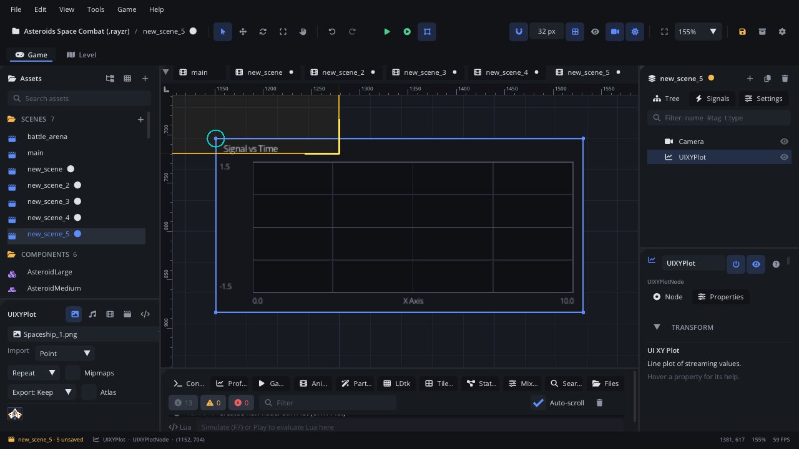

## What it's for

An XY Plot draws one or two lines of data points on a chart with a grid,
axis ranges and a crosshair that reads out the value under the mouse. It's
meant for debug and tool screens: a value over time, a curve, two signals
compared.

## When to use it

- **A debug overlay**: frame time, speed or a physics value plotted while you
  tune the game.
- **Comparing two series** on the same axes (it has a primary and a
  secondary line).
- **Not** for a single current value: use a
  [Progress Bar](UIProgressBarNode.md), or a
  [Volume Meter](UIVolumeMeterNode.md) for a level that peaks and falls.
- **Not** for rows of numbers: use a [Table](UITableNode.md).

## Using it

1. **Add Node** (Ctrl+A) > *UI XY Plot*. It starts 380 x 180 px with the
   title "Signal vs Time", an X range of 0 to 10 and a Y range of -1.5 to
   1.5.
2. Put it under a [Screen Layer](ScreenLayerNode.md) so it stays on screen.
3. In the Node tab's **Properties** section set the axis ranges (**X Min**,
   **X Max**, **Y Min**, **Y Max**), switch **Show Grid**, **Show Points**
   and **Show Crosshair**, and pick **Line Color**, **Secondary Line Color**
   and **Grid Color**.

The data points can't be added in the editor or from Lua yet (there's no
Lua function for them), so for now a plot made in the editor shows its
axes, grid and title but no lines.

## How it works

- **Layout**: the node's position is the top-left corner and **Size** the
  width and height. Rotation and scale don't change it. The title is at the
  top left, the chart area below it, the Y range at the left and the X range
  and axis name under the chart.
- **Axes**: points are placed by the fixed ranges X Min - X Max and Y Min -
  Y Max. Points outside them are pinned to the chart's edge, so set the
  ranges to fit your data.
- **Grid**: four columns and four rows, plus a brighter line at y = 0 when
  zero is inside the Y range.
- **Series**: the primary line in **Line Color** and the secondary line in
  **Secondary Line Color**; each series' name shows top right once it has
  points. **Show Points** marks each point.
- **Crosshair**: with **Show Crosshair** on, hovering the chart draws yellow
  crosshair lines and the X, Y value under the mouse (from the axis ranges).
- **Auto Scale X / Auto Scale Y** are in the Inspector but don't do anything
  yet: the ranges stay as you set them.
- **Screen space**: the mouse is read in screen coordinates, so keep the
  plot under a Screen Layer for the crosshair to line up.

## Example

Zoom the plot's Y axis with the mouse wheel. The script is on the plot and
keeps the range centred on zero.

```lua
---@class PlotZoom : ScriptInstanceBase
local PlotZoom = {}

function PlotZoom:update(dt)
    local wheel = Input.get_mouse_wheel_move()
    if wheel ~= 0 then
        local range = self.node.yMax * (1 - wheel * 0.1)
        range = math.max(0.1, range)
        self.node.yMax = range
        self.node.yMin = -range
    end
end

return PlotZoom
```

## Screenshot


