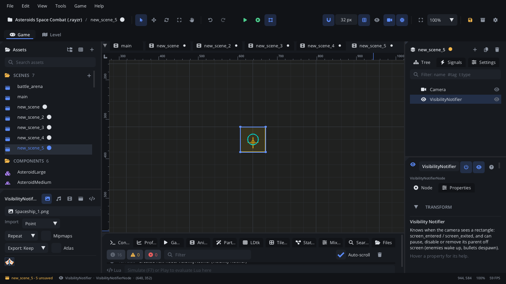

## What it's for

A Visibility Notifier is a rectangle that knows whether the camera can see
it. It raises a signal when it comes on screen and when it leaves, and it
can pause, disable or remove its parent while it's off screen.

## When to use it

- **Enemies that sleep off screen**: they stop thinking and moving until
  the player comes near (**Action**: Pause Parent).
- **Bullets and debris that clean themselves up** once they leave the
  screen (**Action**: Remove Parent).
- **Effects, sounds and animations** that only matter while seen.
- **Something the first time it's seen**: a boss's music, a cutscene, a
  spawn.
- **Not** for "has a body entered this region": use a
  [Trigger Area](AreaNode.md).
- **Not** for "can this character see that one": use a
  [Raycast Sensor](RaycastNode.md).

## Using it

1. Select the node it should watch and **Add Node** (Ctrl+A) >
   *Visibility Notifier*. It becomes a child, so it moves with its parent.
2. Set **Size** to cover the parent's sprite (or a little more). The
   rectangle is centred on the notifier and scales with it.
3. Set **Margin** to have it count as on screen this many pixels before it
   really shows (wake enemies just outside the view).
4. Pick an **Action** for the parent: **None**, **Pause Parent**,
   **Disable Parent** or **Remove Parent**.
5. To react in a script, handle `screen_entered` / `screen_exited`
   (below), or connect them in the Inspector's **Signals** section.

The viewport draws every notifier's rectangle in yellow. In Simulate it's
brighter while the game's camera sees it.

## How it works

- The check uses the scene's current camera (the game's view, not the
  editor's), grown by **Margin**. With no current camera it's the game's
  virtual screen at the origin.
- It runs once per frame for every notifier, after movement, outside the
  normal update. So a paused or disabled parent is still watched and woken
  up.
- **On Screen** is true while the camera sees it. Read it from a script as
  `node.onScreen`.
- On its first check, a notifier that starts on screen raises
  `screen_entered`. One that starts off screen raises nothing until it
  comes on screen (no `screen_exited`), but its **Action** applies at once.
- **Pause Parent**: the parent and its children stop updating (scripts,
  animations, physics) off screen and carry on where they were when seen
  again.
- **Disable Parent**: as Pause, and they aren't drawn either.
- **Remove Parent**: the parent is removed when it leaves the screen, but
  only after it has been on screen once, so a bullet fired from just
  outside the view isn't removed straight away. No `screen_exited` is
  raised for that exit.
- Pause Parent and Disable Parent set the parent's **Paused** /
  **Enabled**: don't also set them yourself on the same node. A notifier at
  the top of the scene has no parent to act on.
- A rotated notifier uses its unrotated rectangle (scaled, not turned).

## Signals

| Signal | When | Value |
|---|---|---|
| `screen_entered` | The camera starts seeing the rectangle | None |
| `screen_exited` | The camera stops seeing it | None |

## Example

A turret that only aims and fires while it's on screen. The turret's child
**VisibilityNotifier** has **Action** None; the script is on the turret.

```lua
---@class Turret : ScriptInstanceBase
local Turret = {}

Turret.properties = {
    fire_delay = { type = "float", default = 1.0, label = "Fire Delay (s)" },
}

function Turret:ready()
    self.active = false
    self.cooldown = 0
    local eye = self.node:get_node("VisibilityNotifier") ---@type VisibilityNotifierNode
    eye:connect("screen_entered", function() self.active = true end)
    eye:connect("screen_exited", function() self.active = false end)
end

function Turret:update(dt)
    if not self.active then return end
    self.cooldown = self.cooldown - dt
    if self.cooldown <= 0 then
        self.cooldown = self.fire_delay
        Scene.instantiate("components/Bullet.component.json", self.node:get_parent(), self.node.position)
    end
end

return Turret
```

Only the first sighting: disconnect the handler when it runs.

```lua
function Boss:ready()
    local eye = self.node:get_node("VisibilityNotifier")
    local id
    id = eye:connect("screen_entered", function()
        eye:disconnect(id)
        Scene.find_node("BossMusic"):music_play()
    end)
end
```

A bullet needs no script: give it a Visibility Notifier with **Action**
Remove Parent. More in the [visibility guide](../../engine/docs/visibility.md).

## Screenshot


