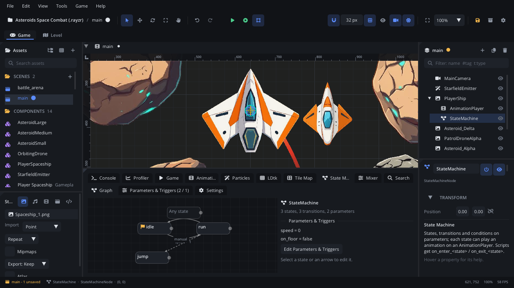
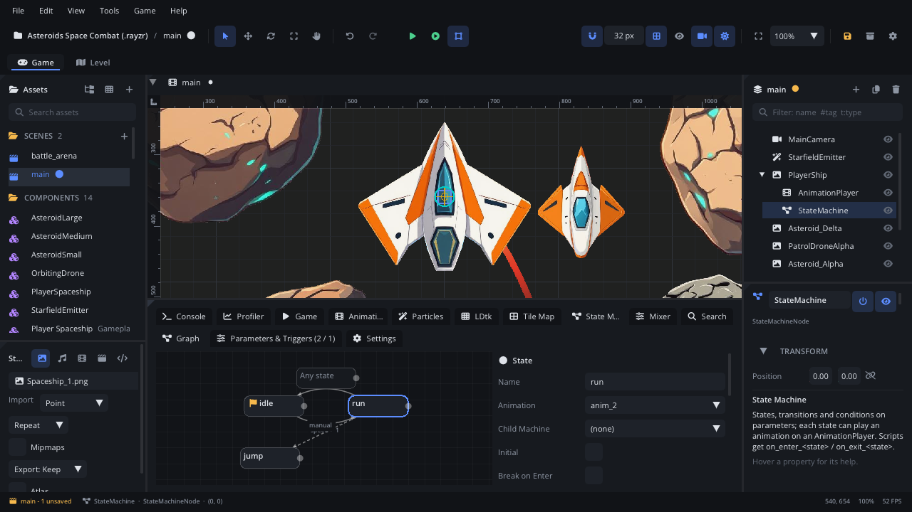
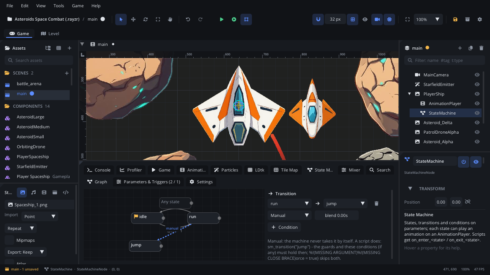
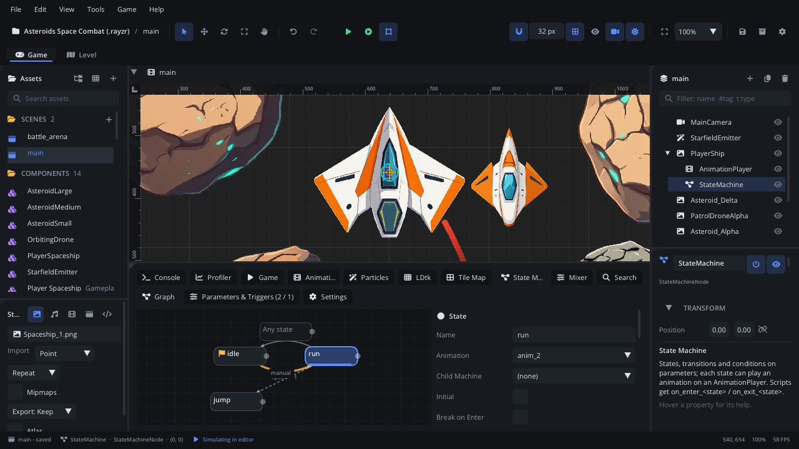
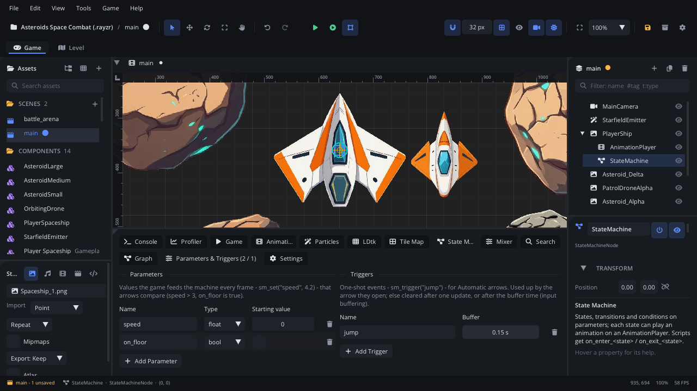
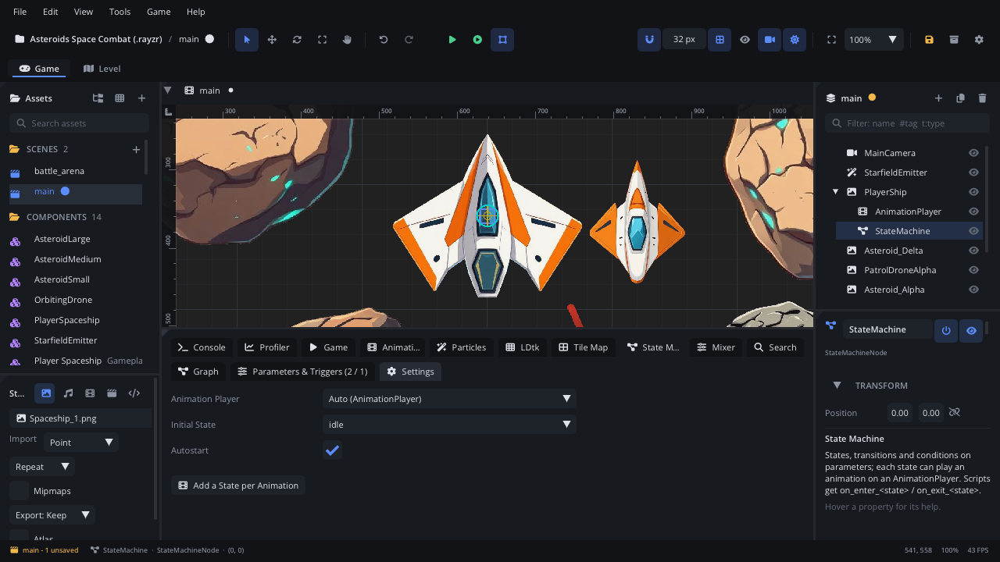

# State machines

A **State Machine** node keeps something in one named **state** at a time -
`idle`, `run`, `jump`; `patrol`, `chase`, `attack`; `closed`, `opening`,
`open` - and changes state along the **arrows** you draw between them. Each
state can play an animation, run a child machine and call your script when
it is entered, every frame while it is current, and when it is left.

Use one when "what is this thing doing right now?" drives both its
animation and its logic: player characters, enemy AI, doors, bosses with
phases, menus. The graph shows every possible change at a glance, the
machine refuses the ones you didn't draw, and while the game runs the
editor lights up the current state and tells you why an arrow didn't fire.

The scripting reference for every method is in the Lua API
(`engine/definitions/engine_api.lua`, *StateMachineNode Methods*); the
tutorials' scenes and scripts below are real files in
[`tests/state_machine/project`](../../tests/state_machine/project), run by
the engine's tests (`engine/state_machine_guide_test.odin`) and played by
the game runner in CI (`tests/state_machine/runtime_tests.json`).

## Concepts

### States

A state has a **name** and, optionally:

- an **animation** it plays on the machine's AnimationPlayer when entered
  (crossfading for the arrow's blend time) - or none: a *gameplay state*
  whose work is in its script callbacks;
- a **child machine**: another State Machine node that runs only while this
  state is current (sub-states: `combat` runs `aim` -> `shoot`);
- **guards** that refuse some changes (below);
- **Allow Retrigger**: the state may go to itself (below).

One state is the **initial** state: the machine starts there.

### Arrows and their mode

An arrow from state A to state B says *the machine may go from A to B*.
Without an arrow, nothing goes from A to B - not even a script asking.
An arrow from **Any state** leads to B from every state (a `hurt` or `dead`
state reachable from anywhere).

Every arrow has a **mode**:

| Mode | Who takes it | Drawn |
|---|---|---|
| **Manual** (the default for new arrows) | Only a script, with `sm_transition("B")`. The change happens inside the call. | dashed |
| **Automatic** | The machine itself, on its update, as soon as the arrow's **conditions** hold (no conditions = at once) and the guards allow it. | solid |

Use **Manual** when your script makes the decision (an enemy that sees the
player, a door opened with a key, a menu button). Use **Automatic** when the
decision is a rule about values the machine already has (`speed > 10`,
the jump button was pressed, the attack animation finished). One machine
can mix both. A script can take an Automatic arrow too (`sm_transition`).

Automatic arrows are checked **in the order they were added** (the order in
the arrow list); the first one that can fire, fires - at most one automatic
change per update.

### Conditions

An arrow's conditions (and a state's *Can leave when* / *Can enter when*
lists) are rows of:

| Condition | Holds when |
|---|---|
| parameter **is true** / **is false** | the parameter is non-zero / zero |
| parameter **==** / **!=** / **>** / **<** value | compares the parameter (floats allow a little rounding: `0.1 + 0.2 == 0.3`) |
| **trigger** | the trigger is set (see below) |
| **animation finished** | the state's animation reached its end; a looping one: once it has looped |
| **after (s)** | the machine has been this many seconds in the state |
| **script says** | a method of the machine's script (else its parent's) returns true |
| **-- or --** | starts another group: the list holds when *any* group holds |

Rows are ANDed: `trigger jump` + `on_floor is true` fires only when both
hold. A missing parameter counts as 0.

### Parameters and triggers

**Parameters** are typed values your script sets every frame with
`sm_set`: **bool** (`on_floor`), **int** (`lives`, `combo_step`) or
**float** (`speed`, `vy`). They describe *how things are*. They keep their
value until set again.

**Triggers** are one-shot events: *something just happened* - a button
press, a hit. `sm_trigger("jump")` sets one; then:

1. The first Automatic arrow it opens takes it, and uses it up.
2. If no arrow can use it, it is **cleared after the first machine update
   that checked it** - so a press can't fire seconds later from another
   state.
3. Unless the trigger has a **buffer** (seconds): then it keeps waiting
   that long. That's *input buffering*: a jump pressed 0.1 s before landing
   still jumps on landing; an attack pressed during the end of the previous
   one chains into the next.

Triggers drive **Automatic arrows only**; `sm_transition` ignores them.
`sm_clear_trigger` cancels one, `sm_trigger_pending` asks if one is still
waiting. A trigger set by a node that updates after the machine is checked
on the machine's next update (it isn't lost).

Rule of thumb: if you'd write `if Input.is_action_pressed(...)`, it's a
trigger; if you'd write `if Input.is_action_down(...)` or read a value, it's
a parameter.

### Guards

An arrow says the machine *may* change; a state can still **refuse**:

| Guard (state side panel) | Refuses |
|---|---|
| **Leave After** (s) | leaving before that many seconds in the state (an attack that can't be cancelled) |
| **Any State Interrupts** (on by default) | off: arrows from Any state don't fire from this state (dead, a cutscene) |
| **Can leave when** | leaving unless these conditions hold (empty = any time) |
| **Can enter when** | entering unless these conditions hold, by any arrow (`dash` only with `stamina > 20`) |
| `can_exit_<state>(next)` | leaving when your script returns false |
| `can_enter_<state>(previous)` | entering when your script returns false |

Guards apply to Automatic arrows and to `sm_transition`;
`sm_transition(state, {force = true})` skips them (and the arrow's
conditions). A refused `sm_transition` returns `false` and the reason, the
same text the editor's live view shows:

```lua
local ok, why = brain:sm_transition("chase")
-- false, "attack: leave after 0.5s (0.20s so far)"
```

### Script callbacks and their order

Define any of these on the machine's script or on its **parent's** script
(both are called when both define them - machine first):

| Callback | When |
|---|---|
| `on_enter_<state>(previous)` | the **first** thing when the state is entered - before its child machine starts and its animation plays. `previous` is `""` at the start. |
| `on_update_<state>(dt)` | every machine update while the state is current - also on the update it was entered (then for the new state) |
| `on_exit_<state>(next)` | the **last** thing before the state is left - after its child machine stopped. `next` is `""` when the machine is stopped (`sm_stop`). |
| `can_exit_<state>(next)` / `can_enter_<state>(previous)` | guards, above |

A change from A to B runs, in order:

```
child machine of A stops -> on_exit_A("B") -> on_enter_B("A") -> child machine of B starts -> B's animation plays -> "state_changed"("B")
```

So `on_enter_` can set things up before the animation starts (pick a
sprite, reset a counter), and `on_exit_` sees everything the state did
(clean up a hitbox).

Changing state from a callback:

- From `on_enter_` and `on_update_`: fine - `sm_transition` there moves on
  at once (a chain). A chain longer than 8 changes stops with a warning
  naming the states (two states sending each other back).
- From a guard, a `script says` condition or `on_exit_`: refused with a
  warning - the machine is deciding or already leaving then.

Right-click a state > **Add Script Callbacks** (or **Add Guard Callbacks**)
writes empty callbacks for it into the script, and the code editor
completes `function Player:on_enter_` with your states' names.

### Child machines

Set a state's **Child Machine** to another State Machine node (usually a
child of the first). It starts (in its initial state) when the state is
entered and stops (its own on_exit runs) when the state is left; a machine
that is some state's child doesn't start by itself. Use it to keep a big
graph readable: `ground` and `air` each with their own sub-states, or a
boss whose `phase2` runs its own attack pattern.

### Allow Retrigger

Normally a state never goes to itself: an Any-state arrow to the current
state is skipped and `sm_transition` to it is refused (*doesn't allow
retriggering*). Tick **Allow Retrigger** on a state that should restart:
then an arrow from it to itself (or from Any state) re-enters it -
`on_exit_`, `on_enter_` and the animation from its first frame again. Use
it for `hurt` (each hit restarts the flinch) or a `shoot` state that fires
again on every press.

## The State Machine tab

Select a State Machine node: the bottom panel's **State Machine** tab shows
it, with three sub-tabs. The Inspector shows only a summary and an **Edit
in State Machine Tab** button.

### Graph



States are boxes (a flag on the initial one, a film icon when it plays an
animation, *gameplay* otherwise, the child machine's name, a lock when it
has guards, a circular arrow for Allow Retrigger, a red dot for Break on
Enter); **Any state** is the extra box. Arrows show their conditions
(`speed > 10`, `jump!` for a trigger, `sees_player()`, `a | b` for
or-groups; Manual ones start with `manual`). **Manual arrows are dashed**,
Automatic ones solid; when two states have arrows both ways the two curve
apart so each can be clicked; an arrow from a state to itself loops over
its box.

- Right-click empty space: **Add State** (a gameplay state) or **Add State
  for Animation**. Right-click a state: Set as Initial, Break on Enter,
  **Add Script Callbacks**, **Add Guard Callbacks**, Delete.
- Drag a box to move it; drag from a box's **dot** onto another box to add
  an arrow - new arrows are Manual. Drag out and back onto the same box for
  an arrow to itself (this turns on its Allow Retrigger). Delete removes the
  selection.
- Wheel or middle button pans, Shift+wheel pans sideways, Cmd/Ctrl+wheel
  zooms, **F** frames everything.

The **side panel** edits the selection:



- a **state**: name, animation (or none), child machine, Initial, Allow
  Retrigger, Break on Enter, its guards (Leave After, Any State Interrupts,
  Can leave when, Can enter when) and which script callbacks exist (with
  buttons to add the missing ones);



- an **arrow**: from / to, **Mode** (Manual / Automatic), blend
  (crossfade seconds for the target's animation) and its conditions
  (**+ Condition**; each row picks a parameter or trigger and an operator).

**Live view.** While Simulate runs - and while the game runs from Play (over
the editor link) - the current state is lit, with a bar for its time; the
arrow that fired flashes. The side panel shows:



- **Ways out**: each arrow out of the current state - *fires*, *waiting for
  speed > 10*, *manual: a script calls sm_transition("chase")*, or
  *blocked: attack: leave after 0.5s (0.20s so far)*; with an arrow selected,
  each condition is green or red;
- the **history** of the last changes (from, to, when, why: `start`,
  `manual`, `forced`, `transition N`);
- **pending triggers** with the buffer time they have left.

**Break on Enter** pauses Simulate (or the running game) when that state is
entered; Resume / Step as usual. It's kept by the editor, not saved in the
scene.

### Parameters & Triggers



- **Parameters**: **Add Parameter**, then its name, **type** (bool / int /
  float) and **starting value** (the value when the scene loads). Renaming
  one renames it in every condition.
- **Triggers**: **Add Trigger**, its name and **buffer** (seconds; 0 = only
  the next update). Renaming renames the conditions too.

While running, each parameter shows its live value and each trigger whether
it is pending (and how long its buffer still keeps it). In Simulate, editing
a value changes the running machine, and **Fire** sets a trigger - handy to
try arrows without a script; the scene's values come back when Simulate
stops.

### Settings



| Setting | |
|---|---|
| **Animation Player** | The player the states' animations play on. Auto: a sibling AnimationPlayer, else a child. |
| **Initial State** | Where the machine starts (also: right-click a state > Set as Initial). |
| **Autostart** | Start on the first update (scripts are ready by then). Off: call `sm_start()`. A child machine never starts by itself. |

**Add a State per Animation** adds a state playing each of the player's
animations that doesn't have one yet.

## Features, one by one

### Automatic arrows from parameters

*For:* animation states that follow the game - idle / run / fall.
*When:* the rule is a comparison of values your script already knows.

```lua
function Player:update(dt)
    local vx, vy = self.node:character_get_velocity()
    self.sm:sm_set("speed", math.abs(vx))
    self.sm:sm_set("on_floor", self.node:character_is_on_floor())
end
```

Arrows: `idle -> run` when `speed > 10`, `run -> idle` when `speed < 10`
(Automatic). Leave a gap between the two numbers if a value hovers around
one threshold (`> 12` / `< 8`) so the states don't flicker.

### Manual arrows and `sm_transition`

*For:* decisions your script makes.
*When:* the reason to change is logic, not a single value - AI, menus,
cutscenes, doors.

```lua
local ok, why = self.brain:sm_transition("chase")
if not ok then Log.info(why) end
```

It needs an arrow from the current state (or Any state); it checks the
guards and - only if the arrow has conditions - the arrow's conditions.
`sm_can_transition("chase")` asks the same question without changing
anything (grey out a button, pick between options). The new state's
callbacks have run when the call returns, so `sm_state()` right after it
is the new state.

### Forcing a change

*For:* things that must happen whatever the state is doing - stunned,
dead, a cutscene starts.

```lua
brain:sm_transition("stunned", { force = true })            -- skips guards and conditions
brain:sm_transition("hurt", { force = true, blend = 0.05 })  -- a quicker crossfade than the arrow's
```

`force` still needs an arrow (an Any-state arrow is the usual one) and
respects Allow Retrigger.

### Triggers with a buffer

*For:* input buffering and queued actions.
*When:* the press can come a little before the moment it's allowed.

Give the trigger a buffer (Parameters & Triggers): 0.1-0.15 s for a jump,
0.2-0.4 s for a combo. Without a buffer a press that can't be used at once
is dropped after one update - the right default for presses that only make
sense *now*.

```lua
if Input.is_action_pressed("jump") then self.sm:sm_trigger("jump") end
-- the player let go / a cutscene started: forget a buffered press
self.sm:sm_clear_trigger("jump")
```

### Animation finished and time in state

*For:* states that last as long as their animation (attacks, landing,
opening) or a fixed time (stunned for 1 s).

Arrows `attack -> idle` when **animation finished** (the animation must not
loop - or it counts once it has looped), `stunned -> patrol` **after (s)**
1. In scripts: `sm_time()` is the time in the current state.

### Script says

*For:* a rule that needs code but should still be an Automatic arrow
(`sees_player()`, `has_key()`).

```lua
function Guard:sees_player()
    local p = Scene.find_node("Player")
    return p ~= nil and self.node.position:distance(p.position) < 200
end
```

The method is on the machine's script, else its parent's. It must only
answer - changing state from it is refused.

### Guards

*For:* "can't be cancelled", "can't be interrupted", "only with stamina".
*When:* the same rule applies to every way in or out of a state - put it on
the state once instead of on every arrow.

```lua
function Player:can_exit_attack(next) return next == "hurt" or self.attack_done end
function Player:can_enter_dash(previous) return self.stamina > 20 end
```

### Callbacks

*For:* the work each state does.

```lua
function Player:on_enter_dash(previous) self.dash_time = 0.2; Audio.play_sound("audio/dash.wav") end
function Player:on_update_dash(dt) self.node:translate(self.facing * 400 * dt, 0) end
function Player:on_exit_dash(next) self.dash_time = 0 end
```

### History and signals

`sm_history()` returns the last 32 changes, oldest first:
`{from, to, time, why}` with `why` = `"start"`, `"manual"`
(`sm_transition`), `"forced"` (with `force`) or `"transition N"` (the
Nth arrow, Automatic). The machine also emits **state_changed**(state)
after each change - connect it in the Signals panel or with `node:connect`.

```lua
for _, c in ipairs(sm:sm_history()) do Log.info(c.from, "->", c.to, c.why) end
```

### Starting and stopping

`sm_start([state])` (re)starts the machine - in a state or the initial one;
a running machine leaves its current state first and pending triggers are
cleared. `sm_stop()` stops it: the child machine stops, then
`on_exit_<state>("")`; `sm_state()` still returns the last state.

## Tutorial 1: a platformer character with input buffering

A character with idle / run / jump / fall, whose jump button works even
when pressed a moment before landing. Files:
[`platformer.scene.json`](../../tests/state_machine/project/scenes/platformer.scene.json),
[`platformer_player.lua`](../../tests/state_machine/project/scripts/platformer_player.lua).

```
Player (CharacterMover, Control Mode Script, platformer_player.lua)
├── Sprite         AnimationPlayer: idle, run, jump, fall
└── StateMachine
```

1. Add the **State Machine** under the player. In **Parameters &
   Triggers** add the parameters `speed` (float), `on_floor` (bool), `vy`
   (float) and the trigger `jump` with a **buffer of 0.15**.
2. In **Graph**, right-click > **Add State for Animation** for idle, run,
   jump and fall; idle is the initial state.
3. Draw these arrows, set each to **Automatic**, in this order:

   | # | Arrow | Conditions |
   |---|---|---|
   | 1 | idle -> jump | trigger `jump`, `on_floor` is true |
   | 2 | run -> jump | trigger `jump`, `on_floor` is true |
   | 3 | idle -> fall | `on_floor` is false |
   | 4 | run -> fall | `on_floor` is false |
   | 5 | idle -> run | `speed` > 10 |
   | 6 | run -> idle | `speed` < 10 |
   | 7 | jump -> fall | `vy` > 0 |
   | 8 | fall -> jump | trigger `jump`, `on_floor` is true |
   | 9 | fall -> idle | `on_floor` is true |

   Arrow 8 comes before arrow 9: on the landing frame both hold, and the
   first one wins - a buffered jump takes off instead of landing.
4. The script moves the character, feeds the machine and does the jump
   when the machine enters Jump:

   ```lua
   function Player:update(dt)
       local node = self.node
       local _, vy = node:character_get_velocity()
       local _, gy = node:character_get_gravity()
       local vx = Input.get_axis("move_left", "move_right") * self.speed
       node:character_set_velocity(vx, vy + gy * dt)
       node:character_move_and_slide(dt)
       vx, vy = node:character_get_velocity()

       -- What the game knows: parameters, set every frame.
       self.sm:sm_set("speed", math.abs(vx))
       self.sm:sm_set("on_floor", node:character_is_on_floor())
       self.sm:sm_set("vy", vy)
       -- What just happened: a trigger.
       if Input.is_action_pressed("jump") then self.sm:sm_trigger("jump") end
   end

   function Player:on_enter_jump(previous)
       local vx = self.node:character_get_velocity()
       self.node:character_set_velocity(vx, -self.jump_velocity)
   end
   ```

5. Play. Press jump while falling, just before touching the ground: the
   character jumps again the moment it lands. Set the buffer to 0 and try
   again: the same press is lost - the machine checked it once, in the
   air, where no arrow could use it.

Why it works: in the air, arrow 8 holds except for `on_floor`, so the
trigger isn't used; with a buffer it stays pending for 0.15 s, and on the
landing frame arrow 8 opens and takes it. The engine test presses jump less
than 0.1 s before landing and checks the machine goes Fall -> Jump on the
landing frame - and that with no buffer it lands in Idle.

## Tutorial 2: enemy AI with manual transitions

An enemy that patrols, chases the player when it sees them, attacks in
reach (an attack lasts at least 0.5 s), and can be stunned at any time.
The script decides; the graph says what's allowed. Files:
[`enemy.scene.json`](../../tests/state_machine/project/scenes/enemy.scene.json),
[`enemy_brain.lua`](../../tests/state_machine/project/scripts/enemy_brain.lua).

```
Enemy (enemy_brain.lua)
└── Brain          StateMachine: patrol, chase, attack, stunned (gameplay states)
Player
```

1. Add four states with **Add State** (no animation needed for the logic;
   give them animations later). patrol is the initial state.
2. Draw the arrows - they are Manual already:
   patrol -> chase, chase -> patrol, chase -> attack, attack -> chase, and
   **Any state** -> stunned. Then stunned -> patrol, set to **Automatic**
   with the condition **after (s)** 1.
3. Select attack; under *Guards* set **Leave After** to 0.5.
4. Each `on_update_<state>` decides when to ask for a change:

   ```lua
   function Enemy:on_update_patrol(dt)
       if self:player_distance() < self.sight then
           self.brain:sm_transition("chase")
           return
       end
       -- ... walk the route
   end

   function Enemy:on_update_chase(dt)
       local d = self:player_distance()
       if d < self.reach then
           self.brain:sm_transition("attack")
       elseif d > self.give_up then
           self.brain:sm_transition("patrol")
       else
           self:move_towards(Scene.find_node("Player").position.x, dt)
       end
   end

   function Enemy:on_update_attack(dt)
       if self:player_distance() >= self.reach then
           local ok, why = self.brain:sm_transition("chase")
           self.last_refusal = (not ok) and why or nil  -- "attack: leave after 0.5s (0.20s so far)"
       end
   end

   -- Called by whatever hits the enemy.
   function Enemy:stun()
       self.brain:sm_transition("stunned", { force = true })
   end
   ```

5. Play (or Simulate) with the State Machine tab open: the current state
   lights up and *Ways out* shows the manual arrows as *manual: a script
   calls sm_transition(...)*; in attack, the attack -> chase arrow shows
   the Leave After countdown.

What the engine test checks: far away it patrols; close, it chases (history
`manual`); in reach it attacks; stepping back during the attack doesn't end
it before 0.5 s (and the refusal says *leave after*); `stun()` mid-attack
goes to stunned at once (`forced`); 1 s later it patrols again by itself
(`transition 6`).

Why Manual here: with Automatic arrows the same AI would need parameters
for every distance check and arrow conditions to match; with Manual arrows
the logic stays in one readable script, and the graph still guarantees the
enemy can't, say, attack straight out of patrol.

## Tutorial 3: a combo chain

Three attacks that chain when the button is pressed again near the end of
each - and only then. Files:
[`combo.scene.json`](../../tests/state_machine/project/scenes/combo.scene.json),
[`combo_fighter.lua`](../../tests/state_machine/project/scripts/combo_fighter.lua).

```
Fighter (combo_fighter.lua)
├── Sprite         AnimationPlayer: idle (loops), attack1, attack2, attack3 (don't loop)
└── Combo          StateMachine
```

1. Add an input action `attack` (Project Settings > Input).
2. In **Parameters & Triggers** add the trigger `attack` with a **buffer
   of 0.3**.
3. States for idle, attack1, attack2, attack3 (Add State for Animation).
4. Automatic arrows, in this order:

   | # | Arrow | Conditions |
   |---|---|---|
   | 1 | idle -> attack1 | trigger `attack` |
   | 2 | attack1 -> attack2 | trigger `attack`, animation finished |
   | 3 | attack2 -> attack3 | trigger `attack`, animation finished |
   | 4 | attack1 -> idle | animation finished |
   | 5 | attack2 -> idle | animation finished |
   | 6 | attack3 -> idle | animation finished |

5. The script only sets the trigger and deals damage:

   ```lua
   function Fighter:update(dt)
       if Input.is_action_pressed("attack") then self.combo:sm_trigger("attack") end
   end

   function Fighter:on_enter_attack1(previous) self.damage_dealt = self.damage_dealt + self.damage1 end
   function Fighter:on_enter_attack2(previous) self.damage_dealt = self.damage_dealt + self.damage2 end
   function Fighter:on_enter_attack3(previous) self.damage_dealt = self.damage_dealt + self.damage3 end
   ```

How it plays: a press during attack1 can't fire arrow 2 yet (the animation
isn't finished), so the trigger waits in its buffer; when attack1 finishes,
arrow 2 holds and comes before arrow 4 - attack2. No press: arrow 4 - back
to idle. A press more than 0.3 s before the end has run out by then - back
to idle, so mashing early doesn't chain; tune the buffer to set how early
a press counts. The engine test checks each of these, the full chain
(10 + 15 + 30 damage) and that with no buffer a press during an attack is
dropped.

Variations: make attack3 Allow Retrigger and add attack3 -> attack3 for an
endless finisher; give attack1 *Leave After* to stop a hurt arrow from Any
state cancelling its first frames (or untick Any State Interrupts).

## Pitfalls

- **An Automatic arrow with no conditions fires at once.** New arrows are
  Manual for that reason; if a state flickers through to the next one,
  check for an Automatic arrow without conditions.
- **Arrow order matters.** The first Automatic arrow that can fire wins.
  Put the specific arrow (trigger + condition) before the general one
  (`fall -> jump` before `fall -> idle`, `attack1 -> attack2` before
  `attack1 -> idle`).
- **Triggers don't wait unless buffered.** A trigger that no arrow can use
  is cleared after one update. If a press "sometimes doesn't work", it
  probably came while a guard or a condition said no - give it a buffer.
- **Triggers don't take Manual arrows.** `sm_trigger` on a machine whose
  arrows are Manual does nothing visible; use `sm_transition`, or make the
  arrow Automatic.
- **`sm_trigger` with an unknown name** returns false and warns once; add
  the trigger in Parameters & Triggers (setting a parameter of that name
  isn't the same thing).
- **A refused `sm_transition` is not an error.** Check its result: `false,
  "attack: leave after 0.5s (0.20s so far)"`. Calling it every frame until
  it works is fine.
- **Don't change state from guards, `script says` conditions or
  `on_exit_`** - it's refused. Do it in `on_enter_`, `on_update_` or your
  own `update`.
- **Two states sending each other back** from `on_enter_` stop after 8
  changes with a warning naming them.
- **"animation finished" never holds** when the animation loops (it holds
  only after a full loop) or when the state plays no animation.
- **The state goes to itself only with Allow Retrigger** - otherwise an
  Any-state `hurt` arrow won't restart `hurt` on a second hit.
- **Callbacks run on both scripts.** If the machine and its parent both
  define `on_enter_jump`, both run (machine first) - define each callback
  in one place.
- **Child machines don't start by themselves**; they run while their
  parent's state is current. To run one alone, clear the parent state's
  Child Machine.

## Moving from `sm_request` / `sm_travel`

`sm_request` and `sm_travel` are gone; `sm_transition` replaces both:

| Before | Now |
|---|---|
| `sm:sm_request("dash")` | `sm:sm_transition("dash")` - guards checked; the arrow's conditions too when it has any |
| `sm:sm_travel("hurt")` | `sm:sm_transition("hurt", { force = true })` |
| `sm:sm_travel("hurt", 0.1)` / `sm_request("dash", 0.1)` | `sm:sm_transition("hurt", { force = true, blend = 0.1 })` |
| `why` = `"request"` / `"travel"` in `sm_history()` | `"manual"` / `"forced"` |

Differences to know:

- `sm_travel` could jump anywhere; `sm_transition` - forced or not - needs
  an arrow from the current state or from Any state. Add an Any-state
  arrow to the states you used to travel to.
- `sm_request` didn't check the arrow's own conditions; `sm_transition`
  does when the arrow has some (force skips them).
- To go to the current state, tick Allow Retrigger on it.
- Callback order changed: `on_enter_` now runs *before* the child machine
  starts and the animation plays; `on_exit_` runs *after* the child
  machine stops; `sm_stop()` now calls `on_exit_<state>("")`; and
  `on_update_` runs on the update a change happened, for the new state.
- `sm_get` returns a typed value (a bool parameter gives true / false) and
  nil for a missing parameter (it used to return 0).

Old scenes load and behave as before:

- **Arrows load as Automatic** (they had no mode). New arrows you draw are
  Manual.
- **Trigger parameters become triggers.** Parameters that `trigger`
  conditions tested are moved to Parameters & Triggers as triggers (buffer
  0) and leave the parameter list (unless other conditions compare them
  too); other parameters load as floats - set their type if you want bool
  or int.
- One behaviour change: old triggers stayed set until an arrow used them;
  now an unused trigger is cleared after one update. If you relied on a
  press waiting through the end of an attack, give that trigger a buffer
  (0.2-0.4 s). Scripts that cleared a trigger with `sm_set(name, 0)` should
  call `sm_clear_trigger(name)`.

## What is saved

In the scene, as `"state_machine"` on the node: the initial state, player,
autostart, the parameters `[name, starting value, type]`, the triggers
`[name, buffer]`, the states (name, animation, child, graph position, Allow
Retrigger, guards) and the arrows (from, to, `"mode": "manual"` or
`"auto"`, blend, conditions). Example from Tutorial 1:

```json
"state_machine": {"initial": "idle", "player": "", "autostart": true,
  "params": [["speed", 0, "float"], ["on_floor", 0, "bool"], ["vy", 0, "float"]],
  "triggers": [["jump", 0.15]],
  "states": [{"name": "idle", "animation": "idle", "pos": [160, 40]}, ...],
  "transitions": [{"from": "fall", "to": "jump", "mode": "auto",
                   "when": [["trigger", "jump"], ["true", "on_floor"]]}, ...]}
```

Break on Enter is the editor's, not saved.

## Performance notes

- A machine's update checks only the arrows out of the current state (and
  Any state) - a handful of comparisons; `script says` conditions and script
  guards call Lua, so keep them cheap.
- The live view's *Ways out* evaluates every condition of every way out;
  it's on only for the machine the editor shows.
- The history is a fixed ring of 32 changes (no allocation per change).
